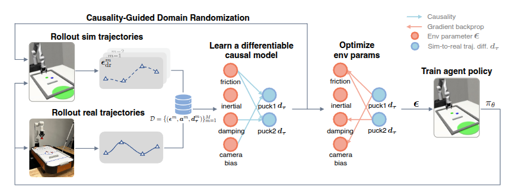
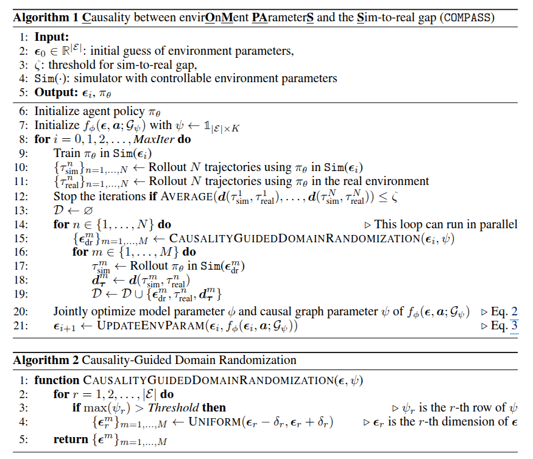
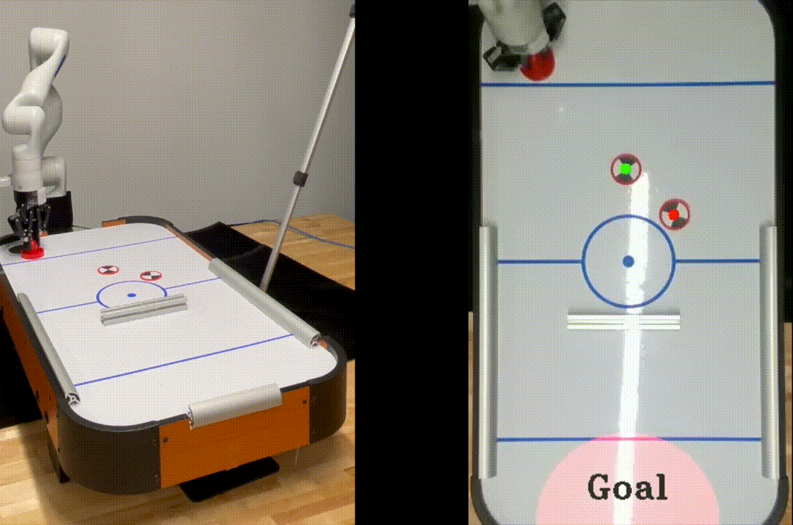
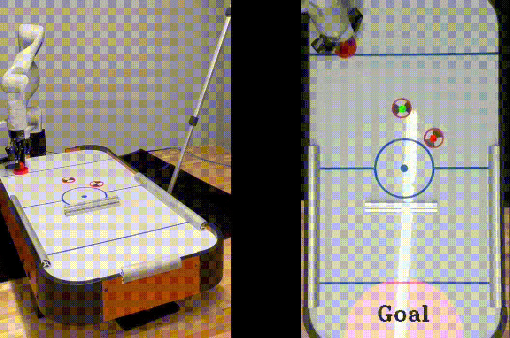

::: {.callout-note title="🔗 Links"}
- [🌐 Project Page](https://sites.google.com/view/sim2real-compass)
- [📄 Paper (arXiv)](https://arxiv.org/abs/2306.15864)
- [📦 Code](https://github.com/XilunZhangRobo/COMPASS-Sim2Real?tab=readme-ov-file)
:::
::: callout-note
Identify parameters that induce simulation-to-real behavior.
:::
## Background and Motivation

이전 논문인 **DiAReL**은 sim-to-real gap 문제를 해결하기 위해 **disturbance awareness**라는 새로운 접근법을 제시했습니다.

저자들은 uncertainty나 disturbance를 명시적으로 추정하고 이를 RL agent의 **state space**에 포함시켰습니다. 하지만 역동역학 모델이 nominal system을 완벽하게 반영하지 못한다면, 추정된 외란은 잘못된 정보를 바탕으로 학습될 수 있습니다.  
또한, nominal system조차 시뮬레이션 상의 물리 엔진에 의존하기 때문에, 이를 정확히 포착한다 하더라도 결국 시뮬레이터의 한계를 벗어나지 못하게 됩니다.

### Sim2Real Gap의 근본 원인

* 시뮬레이션 환경(Source Domain)과 실제 환경(Target Domain) 간에는 불일치가 존재합니다.
* 이 불일치는 단순한 외란이나 노이즈뿐만 아니라, 시뮬레이터 자체가 실제 물리 시스템을 부정확하게 모델링했기 때문에 발생합니다.
* 예: 시뮬레이터의 마찰, 관성, 액추에이터 모델은 실제와 다를 수 있으며, 이를 기반으로 nominal system을 학습하더라도 현실에서는 오차가 발생할 수 있습니다.

특히 접촉(contact) 및 충돌(collision)과 같은 비선형 역학은 간단한 물리 모델로 시뮬레이션 하기에 한계가 있으며, 따라서 실제 세계의 역학을 더 잘 반영하는 방식이 요구됩니다. 아래 소개할 논문은 이를 해결하기 위한 다른 접근을 제안합니다.

---

## Introduction

**Domain Randomization**은 sim-to-real gap을 줄이는 데 효과적이지만, "내 시뮬레이터에 무엇이 잘못되었는가?" 혹은 "sim-to-real gap을 줄이기 위해 어떤 매개변수를 조정해야 하는가?"라는 근본적인 질문에 직접적인 답을 제공하지는 못합니다.

이 논문에서는 실제 환경과 시뮬레이션 환경 간의 불일치를 유발하는 **핵심 환경 매개변수**를 식별하는 estimation framework인 **COMPASS**를 제안합니다.
COMPASS는 **causal relationships**를 통해 시뮬레이터가 실제 환경의 dynamics를 더 잘 모방할 수 있도록 조정합니다.

---

## Related Work

### 1. Gradient-Free Parameter Estimation

이 접근법은 다양한 randomization parameter를 탐색하고 샘플링하여 최적 조합을 찾는 방식입니다. 각 파라미터 조합에 대해 시뮬레이션을 실행하고, 다음 샘플링을 결정하기 위해 heuristic search를 사용합니다. 하지만 파라미터 수가 많아질수록 탐색 비용이 기하급수적으로 증가하므로 효율적이지 않습니다.

### 2. Gradient-Based Parameter Estimation

이 방식은 뉴럴 네트워크를 이용하여 시뮬레이션 환경 파라미터와 실제 환경 간의 불일치를 모델링하거나, gradient 정보를 기반으로 파라미터를 업데이트합니다. 이 과정을 통해 시뮬레이터를 실제 환경에 더 가깝게 만들 수 있습니다.

---

## COMPASS

COMPASS는 환경 매개변수 $\varepsilon$과 action sequence $\mathbf{a} = [a_0, \dots, a_T]$를 궤적 차이 $d_{\tau}$에 매핑하는 **causal model** $f_\phi(\varepsilon, \mathbf{a}; G)$를 학습합니다. 여기서 $G$는 **causal graph**를 나타냅니다.

### Causal Model

Causal model은 시뮬레이터의 환경 매개변수와 로봇의 행동 시퀀스가 시뮬레이션-실제 궤적 차이에 어떤 영향을 미치는지를 학습합니다. 단순한 상관관계가 아닌 **causal relationship**을 추론하는 데 목적이 있습니다.

#### 1. Causal Graph (G)

Causal graph는 환경 매개변수(마찰, 질량 등)가 궤적 차이에 미치는 인과적 영향을 모델링하며, 다음 기능을 제공합니다:

* **Interpretability**: 어떤 파라미터가 영향을 미치는지 시각적으로 해석 가능
* **Search Space Pruning**: 인과 관계가 없는 파라미터를 제외하여 탐색 공간 축소
* **Generalization 향상**: 핵심적인 인과관계에 집중함으로써 unseen 환경에서도 좋은 예측 성능 유지

Causal graph $G$는 binary adjacency matrix $\psi$로 표현되며, $\psi_{ij} = 1$이면 i번째 매개변수가 j번째 궤적 차이에 영향을 미친다는 의미입니다. Gumbel-Softmax를 사용하여 이산적 그래프를 differentiable하게 학습합니다.

Causal graph는 다음 loss를 최소화하며 jointly 학습됩니다:

$$
L_{\phi,\psi} = \frac{1}{M} \sum_{m=1}^{M} \|f_{\phi}(\varepsilon_m, \mathbf{a}_m; G_{\psi}) - d^{(m)}_{\tau}\|_2^2 + \lambda \|\psi\|_p^p
$$

첫 번째 항은 예측 오차, 두 번째 항은 그래프 sparsity 유도 항으로서, 불필요한 causal connection을 제거합니다.

#### 2. Structural Causal Model

Structural Causal Model은 위의 인과 그래프를 이용해 실제 trajectory error를 예측합니다.
이 모델은 학생(f\_\phi), 컨닝페이퍼(G\_\psi), 시험문제(d\_\tau), 채점(loss 계산)으로 비유될 수 있습니다. 학생은 G\_\psi를 활용하여 예측을 수행하며, loss를 줄이기 위해 반복 학습합니다.

## COMPASS 학습 절차

COMPASS는 다음 5단계를 반복 수행하여 시뮬레이터를 실제 환경에 점진적으로 정렬시킵니다.

### Agent Policy 학습 (sim-only)

현재 환경 매개변수 $\varepsilon_i$로 구성된 시뮬레이터에서 RL agent의 policy를 학습합니다.

### Trajectory 수집 (sim + real)

* 훈련된 policy로 $n$개의 simulated trajectory $\tau_{sim}^n$ 수집
* 같은 policy를 실제 로봇에 배포하여 $\tau_{real}^n$ 수집
* 두 궤적 간 평균 오차 $d_\tau$ 계산 → 임계값 이하이면 종료

### Causal 모델 학습용 데이터 생성

* 이전 반복에서 학습한 $G_\psi$를 기반으로 중요한 매개변수만 randomization하여 새로운 $\varepsilon_{dr}^m$ 생성
* 이에 따라 새롭게 $\tau_{sim}^m$ 획득, 기존 $\tau_{real}^n$과 비교하여 $d_\tau^m$ 계산
* 학습 데이터셋 $D$ 구성

### Causal 모델 및 그래프 학습

* 데이터셋 $D$를 사용하여 $f_\phi$와 $\psi$를 공동 최적화
* 손실함수 $L_{\phi,\psi}$ 최소화

### 환경 파라미터 업데이트

* 학습된 $f_\phi$를 통해 $\varepsilon_i$에 대한 gradient 계산
* 이를 따라 $\varepsilon_{i+1}$로 업데이트하고, 다음 반복 진행

이 절차는 궤적 오차가 충분히 작아질 때까지 반복됩니다.

## Air Hockey 실험 환경

:::{layout-ncol=2}
{width=100%}
{width=100%}
:::
*Figure: Comparison between nominal (up) and COMPASS-adjusted environment (down).*  

실험은 **장애물이 포함된 미니 에어하키 환경**에서 수행되었습니다.
에이전트의 목표는 다음과 같은 **복합 조작 과제**를 해결하는 것입니다:

1. 로봇 팔이 **pusher**를 이용해 첫 번째 **puck**을 타격
2. 첫 번째 puck이 두 번째 puck과 **충돌**
3. 두 번째 puck이 **장애물을 피하며 벽을 맞고 목표 지점에 도달**

이 환경은 **물체 간의 충돌**, **하키 테이블의 마찰 특성**, **표면 반응 등 다양한 역학적 상호작용**을 포함합니다.

저자들은 총 **64개의 조절 가능한 환경 파라미터**를 선언했습니다.
이 파라미터들은 다음과 같은 요소들과 관련되어 있습니다:

* 각 물체(pusher, puck1, puck2, 벽, 장애물)의 **동역학 속성**: damping, friction coefficient 등
* **센서 요소**: 예를 들어 카메라 bias 등

---

### COMPASS의 인과 관계 정렬 결과

COMPASS는 초기에는 **모든 파라미터가 연결된 밀집한 인과 그래프**에서 시작하지만, 단 두 번의 반복만에 **매우 희소한 구조의 causal graph**로 정렬되었습니다.

이는 COMPASS가 **실제로 궤적 차이에 인과적 영향을 주는 파라미터만을 효과적으로 식별**했다는 것을 의미합니다.

이 결과는 COMPASS가:

* **도메인 지식 없이도**
* **탐색 공간을 기존 방법 대비 수십 배 축소**하면서도
* 해석 가능성(interpretability)을 제공하는 강력한 도구임을 보여줍니다.

## DiAReL vs. COMPASS

DiAReL에서 사용된 **inverse dynamics model**은 시뮬레이터에서 수집한 데이터를 바탕으로 학습되었습니다.
따라서 이 모델이 생성한 action은 **현실이라면 이렇게 동작했을 것**이 아닌,
**시뮬레이터가 정의한 이상적인 동작**에 불과합니다.

즉, 추정된 외란 역시 **현실 기준의 오차가 아닌, 시뮬레이터 기준에서의 mismatch**입니다.

반면 **COMPASS**는 시뮬레이터의 dynamics를 실제 환경에 맞추기 위한 프레임워크입니다.
실제 환경과 시뮬레이터의 **trajectory 차이**를 기준으로,
**어떤 환경 파라미터가 오차를 유발하는지**를 인과적으로 분석하고,
이를 기반으로 시뮬레이터 파라미터를 조정합니다.

두 방법 모두 일정 기준을 정한 후, 그 기준과의 오차를 측정해 시뮬레이터를 보정하는 방식입니다.
그러나 기준 자체가 다르다는 점에서 접근 방식이 명확히 갈립니다:

| 항목             | DiAReL                                   | COMPASS                                |
| -------------- | ---------------------------------------- | -------------------------------------- |
| 기준 (Reference) | Nominal Simulation Dynamics (사전 정의된 sim) | Real-world Trajectory (실제 환경과의 오차)     |
| 사용 모델          | Inverse Dynamics Model                   | Causal Graph + Structural Causal Model |
| 외란 추정 방식       | 시뮬레이터 모델과의 차이 기반 추정                      | 실제 데이터 기반 궤적 차이를 인과적으로 분석              |
| 목적             | 외란 추정 및 보상 기반 강화학습                       | 시뮬레이터 환경을 실제 환경에 점진적으로 정렬              |

sim-to-real 문제를 효과적으로 해결하기 위해서는 **실제 환경 데이터를 활용한 fine-tuning**이 결국 필요합니다.
물론 fine-tuning은 과정이 복잡하고 시간도 많이 소요되지만,
**nominal dynamics를 잘 정의할 수 있다면**, DiAReL처럼 **DOB 개념을 적용한 접근**이 더 간단하고 효율적일 수도 있습니다. 