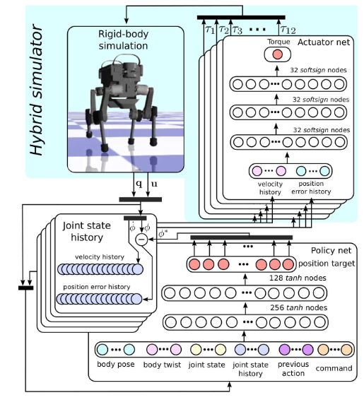
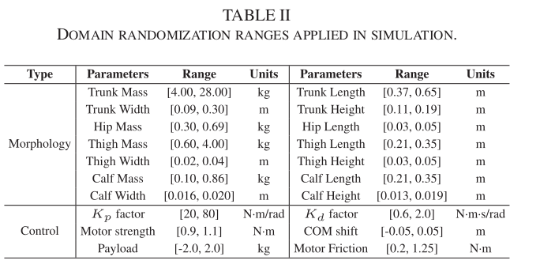
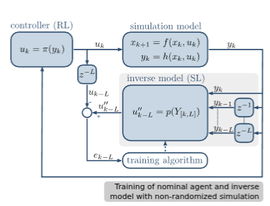
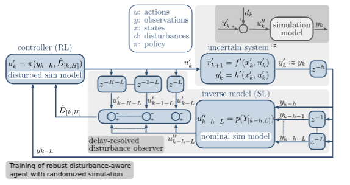

::: {.callout-note title="🔗 Links"}
- [📄 Paper (arXiv)](https://arxiv.org/abs/2306.09010)
:::

## Overview
강화학습을 활용한 로봇 제어 연구는 일반적으로 두 단계로 구성됩니다. 첫 번째 단계에서는 시뮬레이션 내에서 정책(policy)를 학습하고, 두 번째 단계에서는 학습된 policy를 실제 로봇에 적용합니다. 

하지만 시뮬레이션과 현실세계에는 차이가 존재하기 때문에, 동일한 policy라도 시뮬레이션과 실제 환경에서의 동작 결과는 다를 수밖에 없습니다. 이와 같은 문제, 즉 sim-to-real gap을 최소화하려는 연구가 다양하게 진행되어 왔으며, 이 글에서는 몇가지 접근법을 소개합니다.

## Actuator Network
시뮬레이션 내에서 로봇의 각 조인트에 토크를 할당할때는, desired joint position, velocity 등을 입력으로 받아 PD나 PID제어기와 같은 방법을 사용해 토크아웃풋을 만들어냅니다. 하지만 실제 액추에이터는 일반적인 PD controller보다 더 복잡하며, 이로 인해 sim-to-real gap이 발생합니다.

***Learning Agile and Dynamic Motor Skills for Legged Robots***  이 논문에서는 이 문제를 해결하기 위한 새로운 접근법을 제안했습니다. 바로 실제 액추에이터의 특성을 신경망을 이용하여 모델링하는 방법입니다.

이 Actuator Network는 원하는 position 및 velocity와 실제 측정된 position 및 velocity 히스토리를 입력으로 받아, 실제 액추에이터에서 출력되는 토크를 예측하는 구조로 이루어져 있습니다. 이를 위해 실험을 통해 얻은 실제 액추에이터의 데이터를 기반으로 신경망을 학습하며, 이는 일종의 system identification 과정과 유사합니다.

이렇게 학습된 Actuator Network를 사용하면, 시뮬레이션에서의 액추에이터 움직임이 실제 로봇의 특성과 훨씬 더 유사하게 구현됩니다. 결과적으로 정책 학습 단계에서부터 실제 로봇의 특성을 반영할 수 있으며, 이는 sim-to-real gap을 크게 감소시키는 데 도움을 줍니다.

## Domain Randomization
로봇을 시뮬레이션에 구성할 때는 보통 URDF나 MJCF와 같은 모델 파일을 사용합니다. 이러한 파일을 기반으로 만들어진 로봇 모델은 겉보기엔 실제 로봇과 유사하지만, 각 링크의 질량(mass)이나 관성(inertia)등의 물리적 특성이 실제와 완전히 일치하지는 않습니다. 마찬가지로, 시뮬레이션에서 구현한 환경이나 물체들도 현실과는 미세한 격차를 보입니다.  
강화학습 기반의 정책이 이러한 차이를 극복하고 robust하게 동작하도록 하기 위해 Domain Randomization 기법이 널리 사용됩니다.  
기본 아이디어는 간단합니다. 학습 과정에서 로봇의 질량, 관성, 지형의 마찰계수 및 특성, 물체의 크기와 색상, 빛의 반사 특정, 센서 노이즈 등의 파라미터를 고정하지 않고 매 업데이트마다 무작위로 변경하는것입니다.
 

이렇게 Randomization을 수행하면, 학습데이터의 범위가 randomization범위만큼 넓어지게 됩니다. 이는 마치 선형 회귀 문제에서 데이터의 분포가 넓어지는것과 유사하게, 다양한 환경 조건에서도 일반화된 행동을 할 수 있는 policy가 만들어집니다. 따라서 정책의 robustness가 향상되고, 다양한 노이즈나 예상치 못한 환경 변화에도 보다 안정적으로 동작할 수 있게 됩니다.  
다만 Domain Randomization을 도입하면 학습 데이터의 분포가 크게 확장되기 때문에 학습에 더 많은 시간이 필요하며 최적의 파라미터를 찾기 위한 추가적인 작업이 필요합니다.

## DiAReL
Domain Randomization은 강화학습 에이전트가 새로운 환경에 더 잘 일반화할 수 있도록 돕는 효과적인 방법이었습니다.  
하지만 단순히 시뮬레이션 환경의 다양한 요소를 무작위화하는것만으로는 충분하지 않습니다. 에이전트가 이러한 무작위화된 변화, 특히 시스템에 가해지는 외란을 인지하고 추정할 수 있을 때 더 효과적인 강건성(robustness)와 안정성(stabilization)을 달성할 수 있습니다.  
즉, 에이전트가 **다른 환경에 적응**하는 것을 넘어, **환경의 불확실성 자체를 인지하고 강건하게 대응**하도록 만든다면 sim to real gap을 효과적으로 줄일 수 있습니다.

이 논문에서는 이러한 외란을 강화학습 에이전트의 observation space에 포함시키는 Disturbance-Augmented Markov Decision Process를 제안합니다.  
강화학습 에이전트는 단순히 로봇의 위치나 속도같은 nominal state만을 관측하는것이 아니라, 외부에서 가해지는 **외란의 추정치**까지 함께 관측합니다.  
이를 위해 미리 훈련된 Disturbance Observer를 사용하여 시뮬레이션 내에서 randomization으로 주입된 외란을 추정하고, 이 추정된 외란 정보를 에이전트의 observation space에 추가합니다. 조금 더 자세히 살펴보겠습니다.

\

이 논문에서는 시뮬레이션과 실제 로봇 간의 성능차이(sim2real gap)을 극복하기 위해, 이 격차의 주요 원인인 불확실성과 오차를 **unknown intrinsic disturbances**로 개념화합니다.  
먼저, 강화학습 에이전트 훈련에 앞서, **비선형 외란 관측기**의 핵심 구성 요소인 **역동역학 모델**을 미리 훈련합니다. 

### 역동역학 모델 학습 과정
  

위 그림은 역동역학 모델의 훈련 과정을 개략적으로 보여줍니다. 여기서

* $y$는 **observations**
* $u$는 **actions**
* $x$는 시뮬레이션에서의 **true state**를 의미합니다.

시뮬레이션 환경은 다음의 상태 전이 및 관측 모델로 구성됩니다:

$$
x_{k+1} = f(x_k, u_k), \quad y_k = h(x_k, u_k)
$$

위 모델은 논문 저자가 직접 구현한 것이 아니라, 시뮬레이션 환경에서 제공되는 dynamics를 의미합니다.

---

역동역학 모델은 시뮬레이션 환경 내에서 로봇의 **nominal inverse dynamics**를 추정하는 모델로, 다음과 같은 구조를 가집니다:

* 입력: 최근 $L$개의 observation history

  $$
  y_k, \; y_{k-1}, \; y_{k-2}, \dots, y_{k-L}
  $$
* 출력: 해당 관측들을 유발한 과거의 action

  $$
  \hat{u}_{k-L}
  $$

즉, **관측값의 시퀀스를 바탕으로 과거에 어떤 행동이 수행되었는지를 추론**하는 것이 이 모델의 목적입니다.

이 역동역학 모델은 **non-randomized** 시뮬레이션 환경에서 수집된 $(x, u)$ 데이터 쌍을 이용하여 **Supervised Learning** 방식으로 학습됩니다.

간단히 말해, **최근의 상태(observation)로부터 과거의 action을 추론하는 모델**이라고 볼 수 있습니다.

역동역학 모델을 만들었으니, 이제 Disturbance-Aware Reinforcement Learning 구조를 구성할 수 있습니다.

### Disturbance Aware RL

 

이 구조는 DiAReL의 핵심으로, 미리 학습된 역동역학 모델과 강화 학습(RL)을 결합하여, 로봇이 무작위화된(randomized) 환경에서 발생하는 불확실성(uncertainties)과 외란(disturbances)에 강인하게 대처할 수 있는 정책을 학습하도록 하는 것이 목적입니다. 핵심 아이디어는 에이전트의 **관측 공간(observation space)**에 추정된 **외란(estimated disturbances)** 정보를 명시적으로 추가하여, 에이전트가 환경의 불확실성을 **인지**하도록 돕는 것입니다.  

* $k$: 현재 시점을 나타내는 timestep
* $h$: observation delay (sensor delay)
* $L$: 관측값 시퀀스의 길이
* $H$: 외란 추정 시퀀스의 길이 (delay horizon)

즉, 현재 시점이 $k$일 때, 컨트롤러가 실제로 받는 가장 최신 관측값은 다음과 같습니다:

$$
y_{k-h}
$$

#### Controller (RL Policy)

강화학습 policy는 단순히 관측값만을 기반으로 행동을 결정하지 않고, 과거 외란 추정 정보까지 함께 활용합니다.
컨트롤러의 입력은 다음 두 가지로 구성됩니다:

* 최신 관측값: $y_{k-h}$
* 외란 추정 시퀀스:

$$
\hat{D}_{k,H} = [\hat{d}_k, \hat{d}_{k-1}, \dots, \hat{d}_{k-H}]
$$

여기서 $\hat{D}_{k,H}$는 delay-resolved disturbance observer(DOB)로부터 전달받은 외란 시퀀스입니다.
이 시퀀스를 포함하여 policy는 다음과 같이 행동을 결정합니다:

$$
u_k' = \pi(y_{k-h}, \hat{D}_{k,H})
$$

---

### Uncertain System

실제 로봇의 sim-to-real gap과 구조적 불확실성을 반영하기 위해 시뮬레이션 환경에는 무작위 외란 $d_k$가 주입됩니다.
컨트롤러가 생성한 행동 $u_k'$는 이 외란과 결합되어 시스템의 실제 입력으로 작용합니다:

$$
u_k = u_k' + d_k
$$

이 입력에 의해 시스템은 다음 관측값을 생성합니다:

$$
y_k' = h(x_k, u_k)
$$

---

### Delay-resolved Disturbance Observer (DOB)

DOB는 **사전 학습된 역동역학 모델** $P$를 활용하여 외란을 실시간으로 추정합니다.
입력은 관측값 시퀀스:

$$
Y_{k-h,L} = [y_{k-h}, y_{k-h-1}, \dots, y_{k-h-L}]
$$

이를 통해 과거 $L$ 스텝 전의 행동을 추정합니다:

$$
u''_{k-h-L} = P(Y_{k-h,L})
$$

이 예측값은 컨트롤러가 실제로 수행했던 행동 $u'_{k-h-L}$과 비교되어 외란을 추정합니다:

$$
\hat{d}_{k-H} = u'_{k-h-L} - u''_{k-h-L}
$$

이를 $H$ 스텝 동안 반복하여 전체 외란 시퀀스 $\hat{D}_{k,H}$를 구성합니다:

$$
\hat{D}_{k,H} = [\hat{d}_k, \hat{d}_{k-1}, \dots, \hat{d}_{k-H}]
$$

---

### 전체 흐름 요약 (예: 2차원 조인트 명령)

1. 학습된 역동역학 모델 $P$는 관측 시퀀스 $Y_{k-h,L}$를 입력받아 $L$ 스텝 전의 행동 $u''_{k-h-L} \in \mathbb{R}^2$를 예측합니다.
2. 이 예측값은 컨트롤러가 실제로 명령했던 $u'_{k-h-L} \in \mathbb{R}^2$과 비교됩니다.
3. 이 차이를 기반으로 외란 추정값 $\hat{d}_{k-H}$을 구하고, $H$개의 외란 시퀀스를 모아 $\hat{D}_{k,H}$를 구성합니다.
4. 최종적으로, RL policy는 $y_{k-h}$와 $\hat{D}_{k,H}$를 입력으로 하여 $u_k'$를 출력합니다.

---

이러한 구조를 통해 RL 에이전트는 **과거 H 스텝 동안 누적된 외란의 영향을 인지하며** 보다 견고한 행동을 선택할 수 있게 됩니다.

## 정리

역동역학 모델은 **non-randomized 시뮬레이션 환경**에서 사전학습됩니다. 이때 사용되는 정책은 **nominal agent (첫번째 policy)**, 즉 정상 시스템 기준을 제공하는 사전 정의된 policy입니다.  
이후 학습되는 **disturbance-aware agent (두번째 policy)**는, 이 nominal policy가 생성했을 법한 행동과 실제 행동 간의 차이를 외란으로 간주합니다.  

첫번째 policy를 학습한 환경은 non-randomized 이기 때문에 저자들은 이를 ideal policy (optimal policy)로 간주합니다. 즉 **첫번째 policy가 이상적인 환경에서 보여주었던 성능 수준을, 교란이 존재하는 불확실한 환경 에서도 유지할 수 있는 두번째 policy를 만든것**입니다.
