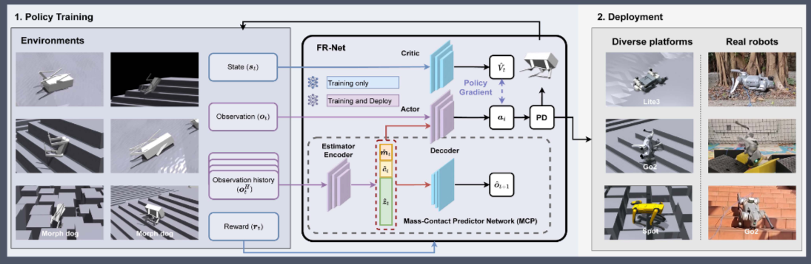
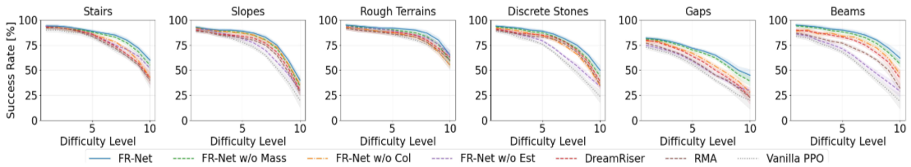
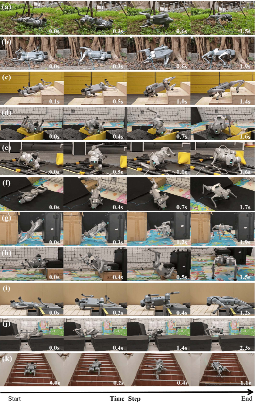
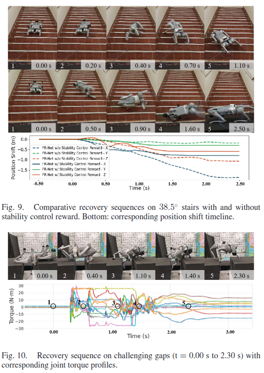
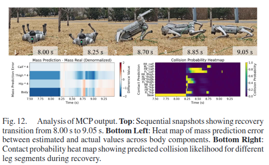

::: {.callout-note title="🔗 Links"}
- [📄 Paper (IEEE RA-L)](https://ieeexplore.ieee.org/document/10999057/)
:::
::: callout-note
Learning based framework that enables quadruped robots to recover from arbitrary fall poses across diverse environments
:::

# 1. 배경 및 문제 정의

복잡한 지형은 로봇의 균형·안정성을 쉽게 무너뜨리며, 낙상 후 **스스로 안정적으로 회복하는 것**은 어려운 과제입니다. 기존 연구는 제한된 센서로 인해 **지형 특성(질감, 경사, 장애물 형태)** 을 충분히 인지하지 못하고, 로봇–지형 간 **비선형·불확실 접촉 상호작용**을 정확히 다루지 못합니다.

## 1.1 Model-based 접근의 한계
- 단순화된 모델 및 미리 정의한 contact point에 의존하여 **비정형·동적 접촉 시나리오**에 취약.
- 이로 인해 **낙상 상태에서의 회복 능력**에 제약이 발생.

## 1.2 Learning-based 접근의 한계
- DRL은 평탄·완만 지형에서는 성과가 있으나, **고도로 불규칙한 지형**에서는 여전히 효과적 회복 전략 학습이 어려움.
- 때때로 **위험한 구르기(dangerous rolling motions)** 와 같은 **불안정 회복 동작**이 나타남.

## 1.3 본 논문의 목표
- **범용 회복성**: 어느 낙상 자세·환경에서도 회복 가능한 **일반화된 회복 능력** 확보.
- **제한 센서로 정확 추정**: 제한된 센서만으로 **질량 분포**와 **접촉 상태**를 추정하여, 불완전 인지·불확실 상호작용 문제를 완화. 이를 담당하는 핵심 모듈이 **Mass–Contact Predictor (MCP)** 입니다.

# 2. Mass–Contact Predictor (MCP)

MCP는 **VAE 기반**으로, 순수 **proprioception 시퀀스**만으로 다음을 추정합니다.

- $m_{t}$ (**질량 분포**): base, hip, thigh, calf 등 주요 세그먼트의 상대적 질량(=무게중심 기여)을 추정 → 전체 무게중심(CoM) 예측에 기여.
- $c_{t}$ (**충돌 확률**): 발뿐 아니라 몸체 각 부위의 **환경 접촉 확률**을 예측(이진이 아니라 확률로 표현하여 **불확실성 반영**).
- $z_{t}$ (**컨텍스트**): 로봇 동역학·환경을 압축한 **잠재 벡터**로, **시간적 특징**을 포착.

**디코더**는 $m_{t}$,  $c_{t}$,  $z_{t}$  로 **다음 시점 관측** $o_{t+1}$을 예측하여, **self-supervised** 방식으로 의미 있는 표현을 학습시킵니다.

### 2.1 학습 손실
- **질량 추정 손실**: 예측 질량 분포 vs. 실제 질량의 **MSE** 최소화.
- **충돌 추정 손실**: 예측 충돌 확률 vs. 실제 접촉 정보의 **BCE** 최소화.
- **VAE 손실**: **재구성 손실 + KL 발산**(표준 VAE 구성).

> **특징**: FR-Net의 MCP는 **질량 분포 추정**과 **접촉 추정**을 **단일 네트워크**로 통합하여, **내부 물리 특성**과 **외부 접촉 상호작용**을 동시에 파악합니다. 발 외에도 **몸통 접촉 확률**까지 추정해, 발 지지 상실 시 **몸통을 활용한 안전한 회복 전략**까지 가능하게 합니다.

# 3. FR-Net과 정책 학습

- MCP의 예측 $m_{t}$,  $c_{t}$,  $z_{t}$ 는 **actor의 보강 상태 $p_{t}$** 의 일부로 주입되어 **제어 입력**에 직접 영향.
- 목적: **불안정한 회복 동작을 억제**하고, 다양한 낙상 자세·지형에서 **안전·견고한 회복**을 달성하는 정책 학습.

# 4. 실험 구성 및 결과

## 4.1 Ablation 설정
- **FR-Net w/o mass**  
- **FR-Net w/o col**  
- **FR-Net w/o Est** (MCP 전체 제거)  
- **DreamRiser** (latent 및 $v_{t}$만 활용)  
- **Vanilla PPO**

## 4.2 시뮬레이션 결과(요약)
- **Level 1–3**: 모든 방법이 **90%+ 성공률**.  
- **최대 난이도 Level 10**: **FR-Net 69.5%**로, **Vanilla PPO 대비 +21.8%p** 향상.  
- 기타 환경의 **Level 10**에서도 FR-Net이 일관되게 **상대 우위**.

## 4.3 실제 환경 시연

- **가파른 계단**: **안정성 보상**(무릎 등 관절이 지형과 접촉 시 발생하는 수평력 패널티)을 적용한 FR-Net은 **구르기 없이** 안전 회복. 보상 미적용 시 **구르기 발생**.  
- **틈새**: 두 다리가 **틈새에 빠지는 상황**에서도 지지면을 재구성하며 회복.  
- **빔(폭 좁은 지지면)**: **3발 접촉**만으로도 회복 성공.  
- **MCP 출력 분석**: 실제 동적 움직임에서 **질량 추정 정확도 향상**, 외부 센서 없이도 **부위별 접촉 확률**을 성공적으로 예측.

# 5. 결론

FR-Net은 복잡·불규칙 지형에서의 **낙상 회복**을 정량·정성적으로 입증했습니다.  
MCP가 제공하는 **질량 분포**와 **접촉 상태**는 강화학습 정책의 핵심 보강 정보로 작용하며, ablation으로 그 중요성이 확인되었습니다. 또한 **안정성 보상**은 기존 방법의 문제였던 **구르기 동작**을 억제하여 **안전한 회복**을 가능하게 함을 시뮬레이션과 실제 실험에서 모두 검증했습니다.