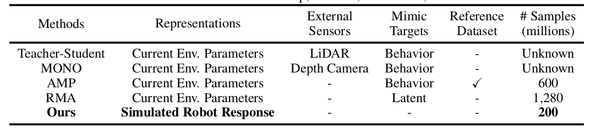

::: {.callout-note title="🔗 Links"}
- [🌐 Project Page](https://open-robot-lab.github.io/HIMLoco/)
- [📄 Paper (arXiv)](https://arxiv.org/abs/2312.06370)
- [📦 Code](https://github.com/OpenRobotLab/HIMLoco)
:::

::: callout-note
Learning robust locomotion by modeling the robot's response via contrastive learning
:::

본 포스트는 HIMLoco 논문 중 **Estimator Network의 구조와 학습 방법론(HIO)**을 중점적으로 분석합니다.

# 1. 배경 및 문제 정의

기존의 Model-based RL이나 DreamWaQ와 같은 연구들은 **World Model**이나 **Representation**을 학습하기 위해 주로 **회귀(Regression)** 목적함수를 사용했습니다. 즉, 신경망이 다음 상태(Next State)나 환경 파라미터(마찰계수, 지형 높이 등)를 직접 예측하도록 학습시킵니다.

그러나 이러한 접근 방식은 **Sim-to-Real**을 위해 필수적인 **도메인 랜덤화(Domain Randomization)** 과정에서 아래와 같은 단점이 있습니다.

-   **불확실성의 증대**: 시뮬레이션에 추가된 과도한 무작위 노이즈까지 신경망이 학습해야 합니다.
-   **표현 붕괴 (Representation Collapse)**: 신경망이 물리적으로 유의미한 정보(Dynamics)가 아니라, 무작위 노이즈 패턴에 과적합되면서 실제 환경에서는 엉뚱한 추정값을 내놓는 현상이 발생합니다.

> **HIMLoco의 접근**:  
> "Regression 대신 **상황의 맥락(Context)을 구별(Contrastive)**"

# 2. HIMLoco 개요

HIMLoco는 고전 제어 이론인 **IMC (Internal Model Control)**에서 영감을 받아, 외부 환경 변수 자체가 아니라 이에 대한 **로봇의 반응(Response)**을 나타내는 **Hybrid Internal Embedding**을 학습합니다.

핵심은 **대조 학습(Contrastive Learning)**을 통해 Latent Vector를 생성한다는 점입니다.
-   **Positive Pairs**: 시계열적으로 연관된 과거와 미래 데이터는 잠재 공간에서 가깝게 위치시킵니다.
-   **Negative Pairs**: 서로 다른 맥락의 데이터는 멀리 위치시킵니다.

이 방식은 개별 샘플의 수치적 노이즈보다는 **샘플 간의 상대적인 관계**에 집중하기 때문에 노이즈에 강건하며, **Batch-level** 정보를 활용하여 훨씬 견고한 표현(Representation)을 학습할 수 있습니다.

# 3. Estimator Network 구조

Estimator Network는 과거의 관측 기록을 통해 현재의 상태를 추론하는 핵심 모듈입니다.

## 3.1 Source Encoder
* **역할**: 과거의 관측 기록($o_{t-H:t}$)을 입력받아 두 가지 정보를 출력합니다.
    1.  **명시적 속도 ($\hat{v}_t$)**: 로봇의 선속도 추정값 (Supervised Learning 대상)
    2.  **잠재 벡터 ($l_t^{source}$)**: 지형 및 상태 맥락 정보 (Self-Supervised Learning 대상)
* **차원**: Input(270) $\rightarrow$ Output(19: 속도 3 + Latent 16)
* **특징**: 지도 학습과 자기 지도 학습을 동시에 수행하는 **Hybrid 구조**입니다.

## 3.2 Target Encoder
* **역할**: 미래의 관측값($o_{t+1}$)을 입력받아 **Target Latent ($l_t^{target}$)**를 생성합니다.
* **차원**: Input(45) $\rightarrow$ Output(16)
* **의미**: 미래 시점의 상태가 과거 기록이 예측해야 할 **지향점(Target)** 역할을 합니다.

## 3.3 Prototypes
* **역할**: 잠재 공간 내에서 **군집의 중심(Cluster Centroids)** 역할을 하는 학습 가능한 벡터 집합입니다.
* **구조**: $32 \times 16$ 크기의 행렬 (32개의 프로토타입, 각 16차원).
* **학습**: 역전파를 통해 데이터의 분포에 맞춰 이 프로토타입 벡터들의 위치도 지속적으로 업데이트됩니다.

# 4. 학습 과정: Hybrid Internal Optimization (HIO)

Estimator의 최종 손실 함수는 다음과 같이 정의됩니다.

$$
\mathcal{L}_{total} = w_{vel} \cdot \mathcal{L}_{vel} + w_{con} \cdot \mathcal{L}_{con}
$$

여기서 첫 번째 항은 속도 추정에 대한 MSE Loss이며, 핵심이 되는 두 번째 항 $\mathcal{L}_{con}$은 **Swapped Prediction Loss**를 사용합니다. 그 상세 과정은 다음과 같습니다.

### 4.1 임베딩 및 정규화 (Embedding & Normalization)

먼저 Source/Target Encoder를 통해 나온 Latent Vector를 **L2-Normalization** 하여 $z_s, z_t$를 생성합니다.

$$
z = \frac{l}{\|l\|_2}
$$

벡터의 크기를 1로 통일함으로써, 이후 수행될 내적 연산이 온전히 **방향성(코사인 유사도)**만을 나타내도록 만듭니다. 프로토타입 벡터($e_k$)들도 동일하게 정규화됩니다.

### 4.2 프로토타입 매칭 (Prototype Matching)

현재의 Latent Vector ($z$)가 32개의 프로토타입 중 어디에 가까운지 **유사도 점수(Score)**를 계산합니다.

$$
\text{Scores} = z \cdot C^T
$$

이 내적 연산을 통해, $z_s$가 프로토타입 $e_1$과는 0.9만큼 비슷하고, $e_2$와는 0.1만큼 비슷하다는 식의 점수 분포를 얻게 됩니다.

### 4.3 Sinkhorn 알고리즘: 정답지(Q) 생성

이 과정은 단순한 예측($p$)이 아니라, 학습의 기준이 될 **이상적인 정답지($q$)**를 만드는 과정입니다.

1.  **점수 변환**: 내적 점수를 확률 밀도 형태($Q = \exp(\text{score}/\epsilon)$)로 변환합니다.
2.  **Iterative Normalization**: 행렬의 행과 열을 번갈아 가며 정규화합니다.

이 과정의 목적은 **붕괴(Collapse) 방지**입니다. 단순히 Softmax를 쓰면 네트워크가 모든 데이터를 "가장 쉬운 프로토타입 1개"에 몰아넣는 꼼수를 부릴 수 있습니다. Sinkhorn 알고리즘은 **"모든 프로토타입에 샘플이 $1/K$만큼 균등하게 할당되어야 한다"**는 제약 조건을 만족시키며 최적의 할당 행렬 $Q$를 찾습니다.

결과적으로 $q_s$ 및 $q_t$는 **전체 배치의 균형을 고려했을 때, 각 샘플이 속해야 하는 이상적인 프로토타입 확률 분포**가 됩니다.

### 4.4 Swapped Prediction Loss

마지막으로, **과거(Source)**와 **미래(Target)**가 서로의 정답지를 예측하도록 교차 학습을 수행합니다.

$$
\mathcal{L}_{con} = - \frac{1}{2H} \sum_{t=1}^{H} \left( q_s \log p_t + q_t \log p_s \right)
$$

여기서 $p_s$와 $p_t$는 내적 점수에 Temperature Softmax를 적용한 **네트워크의 자체 예측값**입니다.

$$
p_t = \text{Softmax}\left(\frac{z_t \cdot C^T}{\tau}\right)
$$

#### 손실 함수의 작동 원리
1.  **예측($p$) vs 정답($q$)**: $p$는 현재 네트워크가 생각하는 주관적인 확률이고, $q$는 Sinkhorn을 통해 보정된 객관적인 목표입니다.
2.  **Swapping (교차)**:
    * **과거의 예측($p_s$)**은 **미래의 정답($q_t$)**을 맞추도록 학습됩니다.
    * **미래의 예측($p_t$)**은 **과거의 정답($q_s$)**을 맞추도록 학습됩니다.

#### 최종 학습 의도 ($z_t$의 의미)
이러한 교차 예측을 통해 Latent Vector $z_t$는 다음과 같은 특성을 가지게 됩니다.

* **시간적 일관성 (Temporal Consistency)**: 시간 $t$에서 $t+1$로 넘어가더라도 변하지 않는 지형의 본질적 특성을 담게 됩니다.
* **강건한 표현력**: 구체적인 수치(마찰계수 등)를 맞추는 것이 아니라, **"현재 상황이 어떤 프로토타입(유형)에 속하는지"**를 학습함으로써 노이즈에 휘둘리지 않는 강건한 Context 정보를 Actor에게 제공합니다.