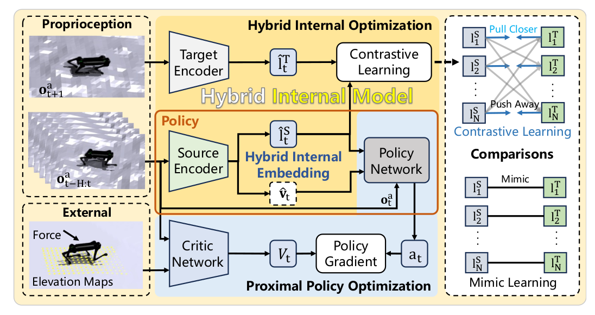
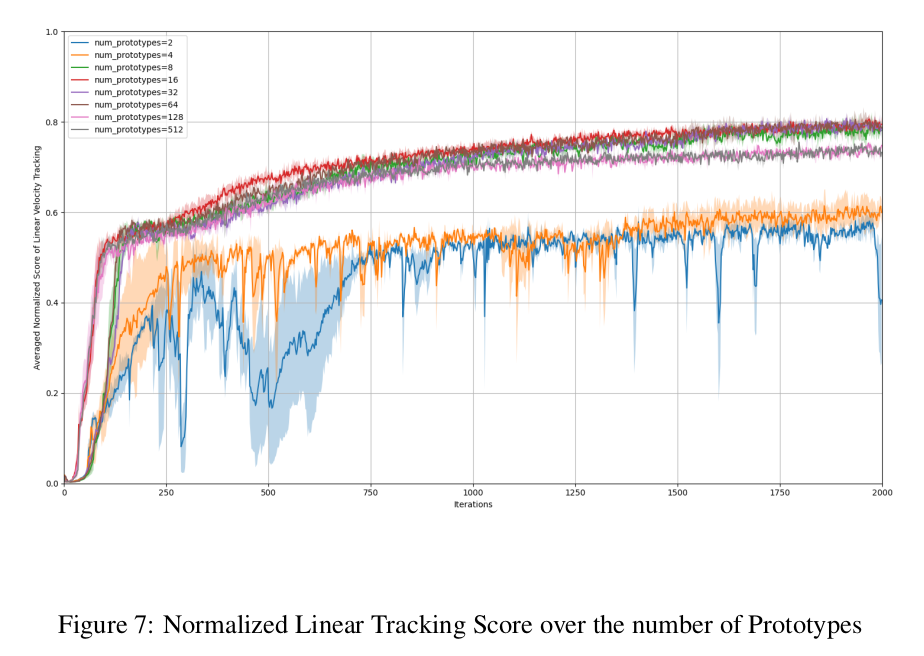
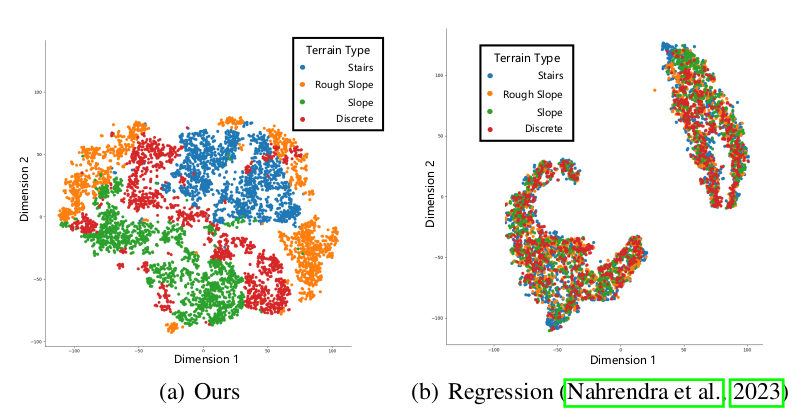

::: {.callout-note title="🔗 Links"}
- [🌐 Project Page](https://open-robot-lab.github.io/HIMLoco/)
- [📄 Paper (arXiv)](https://arxiv.org/abs/2312.06370)
- [📦 Code](https://github.com/OpenRobotLab/HIMLoco)
:::

::: callout-note
Learning robust locomotion by modeling the robot's response via contrastive learning
:::

본 포스트는 HIMLoco 논문 중 **Estimator Network의 구조와 학습 방법론(HIO)**을 중점적으로 분석합니다.

# 배경 및 문제 정의

기존의 Model-based RL이나 DreamWaQ와 같은 연구들은 **World Model**이나 **Representation**을 학습하기 위해 주로 **회귀(Regression)** 목적함수를 사용했습니다. 즉, 신경망이 다음 상태(Next State)나 환경 파라미터(마찰계수, 지형 높이 등)를 직접 예측하도록 학습시킵니다.

그러나 이러한 접근 방식은 **Sim-to-Real**을 위해 필수적인 **도메인 랜덤화(Domain Randomization)** 과정에서 아래와 같은 단점이 있습니다.

-   **불확실성의 증대**: 시뮬레이션에 추가된 과도한 무작위 노이즈까지 신경망이 학습해야 합니다.
-   **표현 붕괴 (Representation Collapse)**: 신경망이 물리적으로 유의미한 정보(Dynamics)가 아니라, 무작위 노이즈 패턴에 과적합되면서 실제 환경에서는 엉뚱한 추정값을 내놓는 현상이 발생합니다.

> **HIMLoco의 접근**:  
> "Regression 대신 **상황의 맥락(Context)을 구별(Contrastive)**"

# HIMLoco 개요

HIMLoco는 고전 제어 이론인 **IMC (Internal Model Control)**에서 영감을 받아, 외부 환경 변수 자체가 아니라 이에 대한 **로봇의 반응(Response)**을 나타내는 **Hybrid Internal Embedding**을 학습합니다.

핵심은 **대조 학습(Contrastive Learning)**을 통해 Latent Vector를 생성한다는 점입니다.
-   **Positive Pairs**: 시계열적으로 연관된 과거와 미래 데이터는 잠재 공간에서 가깝게 위치시킵니다.
-   **Negative Pairs**: 서로 다른 맥락의 데이터는 멀리 위치시킵니다.

이 방식은 개별 샘플의 수치적 노이즈보다는 **샘플 간의 상대적인 관계**에 집중하기 때문에 노이즈에 강건하며, **Batch-level** 정보를 활용하여 훨씬 견고한 표현(Representation)을 학습할 수 있습니다.

# Estimator Network 구조

Estimator Network는 과거의 관측 기록을 통해 현재의 상태를 추론하는 핵심 모듈입니다.

## Source Encoder
* **역할**: 과거의 관측 기록($o_{t-H:t}$)을 입력받아 두 가지 정보를 출력합니다.
    1.  **명시적 속도 ($\hat{v}_t$)**: 로봇의 선속도 추정값 (Supervised Learning 대상)
    2.  **잠재 벡터 ($l_t^{source}$)**: 지형 및 상태 맥락 정보 (Self-Supervised Learning 대상)
* **차원**: Input(270) $\rightarrow$ Output(19: 속도 3 + Latent 16)
* **특징**: 지도 학습과 자기 지도 학습을 동시에 수행하는 **Hybrid 구조**입니다.

## Target Encoder
* **역할**: 미래의 관측값($o_{t+1}$)을 입력받아 **Target Latent ($l_t^{target}$)**를 생성합니다.
* **차원**: Input(45) $\rightarrow$ Output(16)
* **의미**: 미래 시점의 상태가 과거 기록이 예측해야 할 **지향점(Target)** 역할을 합니다.

## Prototypes
* **역할**: 잠재 공간 내에서 **군집의 중심(Cluster Centroids)** 역할을 하는 학습 가능한 벡터 집합입니다.
* **구조**: $32 \times 16$ 크기의 행렬 (32개의 프로토타입, 각 16차원).
* **학습**: 역전파를 통해 데이터의 분포에 맞춰 이 프로토타입 벡터들의 위치도 지속적으로 업데이트됩니다.

# 학습 과정: Hybrid Internal Optimization (HIO)

Estimator의 최종 손실 함수는 다음과 같이 정의됩니다.

$$
\mathcal{L}_{total} = w_{vel} \cdot \mathcal{L}_{vel} + w_{con} \cdot \mathcal{L}_{con}
$$

여기서 첫 번째 항은 속도 추정에 대한 MSE Loss이며, 핵심이 되는 두 번째 항 $\mathcal{L}_{con}$은 **Swapped Prediction Loss**를 사용합니다. 그 상세 과정은 다음과 같습니다.

### 임베딩 및 정규화 (Embedding & Normalization)

먼저 Source/Target Encoder를 통해 나온 Latent Vector를 **L2-Normalization** 하여 $z_s, z_t$를 생성합니다.

$$
z = \frac{l}{\|l\|_2}
$$

벡터의 크기를 1로 통일함으로써, 이후 수행될 내적 연산이 온전히 **방향성(코사인 유사도)**만을 나타내도록 만듭니다. 프로토타입 벡터($e_k$)들도 동일하게 정규화됩니다.

### 프로토타입 매칭 (Prototype Matching)

현재의 Latent Vector ($z$)가 32개의 프로토타입 중 어디에 가까운지 **유사도 점수(Score)**를 계산합니다.

$$
\text{Scores} = z \cdot C^T
$$

이 내적 연산을 통해, $z_s$가 프로토타입 $e_1$과는 0.9만큼 비슷하고, $e_2$와는 0.1만큼 비슷하다는 식의 점수 분포를 얻게 됩니다.

### Sinkhorn 알고리즘: 정답지(Q) 생성

이 과정은 단순한 예측($p$)이 아니라, 학습의 기준이 될 **이상적인 정답지($q$)**를 만드는 과정입니다.

1.  **점수 변환**: 내적 점수를 확률 밀도 형태($Q = \exp(\text{score}/\epsilon)$)로 변환합니다.
2.  **Iterative Normalization**: 행렬의 행과 열을 번갈아 가며 정규화합니다.

이 과정의 목적은 **붕괴(Collapse) 방지**입니다. 단순히 Softmax를 쓰면 네트워크가 모든 데이터를 "가장 쉬운 프로토타입 1개"에 몰아넣는 꼼수를 부릴 수 있습니다. Sinkhorn 알고리즘은 **"모든 프로토타입에 샘플이 $1/K$만큼 균등하게 할당되어야 한다"**는 제약 조건을 만족시키며 최적의 할당 행렬 $Q$를 찾습니다.

결과적으로 $q_s$ 및 $q_t$는 **전체 배치의 균형을 고려했을 때, 각 샘플이 속해야 하는 이상적인 프로토타입 확률 분포**가 됩니다.

### Swapped Prediction Loss

마지막으로, **과거(Source)**와 **미래(Target)**가 서로의 정답지를 예측하도록 교차 학습을 수행합니다.

$$
\mathcal{L}_{con} = - \frac{1}{2H} \sum_{t=1}^{H} \left( q_s \log p_t + q_t \log p_s \right)
$$

여기서 $p_s$와 $p_t$는 내적 점수에 Temperature Softmax를 적용한 **네트워크의 자체 예측값**입니다.

$$
p_t = \text{Softmax}\left(\frac{z_t \cdot C^T}{\tau}\right)
$$

#### 손실 함수의 작동 원리
1.  **예측($p$) vs 정답($q$)**: $p$는 현재 네트워크가 생각하는 주관적인 확률이고, $q$는 Sinkhorn을 통해 보정된 객관적인 목표입니다.
2.  **Swapping (교차)**:
    * **과거의 예측($p_s$)**은 **미래의 정답($q_t$)**을 맞추도록 학습됩니다.
    * **미래의 예측($p_t$)**은 **과거의 정답($q_s$)**을 맞추도록 학습됩니다.

#### 최종 학습 의도 ($z_t$의 의미)
이러한 교차 예측을 통해 Latent Vector $z_t$는 다음과 같은 특성을 가지게 됩니다.

* **시간적 일관성 (Temporal Consistency)**: 시간 $t$에서 $t+1$로 넘어가더라도 변하지 않는 지형의 본질적 특성을 담게 됩니다.
* **강건한 표현력**: 구체적인 수치(마찰계수 등)를 맞추는 것이 아니라, **"현재 상황이 어떤 프로토타입(유형)에 속하는지"**를 학습함으로써 노이즈에 휘둘리지 않는 강건한 Context 정보를 Actor에게 제공합니다.

---

**[Step-by-Step 정리]**

## [Step 1] 정규화 (Normalization)

::: {.callout-note}
### 핵심 직관
"모든 선수의 키를 1로 맞춰서, 오직 **플레이 스타일(방향)**만 비교하겠다."
:::

### 입력 변수 및 차원
* `z_student`: ($B$, $D$) = **(128, 16)**
* `z_teacher`: ($B$, $D$) = **(128, 16)**
* `prototypes`: ($K$, $D$) = **(32, 16)**

### 연산: L2 Normalization
벡터 $v$에 대하여 다음 연산을 수행합니다.

$$
v_{norm} = \frac{v}{||v||_2}
$$

### 분석
* **결과:** 모든 벡터($z$, prototypes)가 원점으로부터 반지름이 1인 **초구(Hypersphere)** 표면 위에 위치하게 됩니다.
* **목적:** 내적(Dot Product) 연산 시 벡터의 **크기(Magnitude)**가 결과에 영향을 주지 않도록 통제합니다. 오직 벡터 간의 **각도(Angle)**만을 기준으로 유사도를 판단하기 위함입니다.
    * 정규화 후 내적: $A \cdot B = 1 \times 1 \times \cos\theta = \cos\theta$ (코사인 유사도와 동일)

---

## [Step 2] Scores 계산 (Similarity Matrix)

::: {.callout-note}
### 핵심 직관
"학생(데이터)이 32개의 바구니(프로토타입)를 보고 각각 얼마나 마음에 드는지 점수 매기기."
:::

### 연산: Matrix Multiplication
정규화된 학생 latent 벡터와 프로토타입의 전치 행렬을 내적합니다.

$$
\text{Scores} = z_{\text{student}} \times \text{prototypes}^T
$$

### 차원 분석
$$
(128, 16) \times (16, 32) \rightarrow \mathbf{(128, 32)}
$$

### 분석
* 생성된 `scores_s` 행렬의 $(i, j)$번째 값은 **$i$번째 데이터 이미지**와 **$j$번째 프로토타입** 간의 **코사인 유사도**입니다.
* 값의 범위는 **-1 (완전 반대)** 에서 **1 (완전 일치)** 사이입니다.

이 점수(Score)가 높다는 것은 입력된 데이터의 잠재 표현(Latent Representation)이 특정 프로토타입 군집의 중심과 매우 유사함을 의미합니다. 예를 들어, 특정 프로토타입이 **'계단 지형에서의 동역학적 특징'**을 학습했다고 가정해 봅시다. 로봇이 실제로 계단을 통과하며 얻은 관측 데이터(Observation)가 엔코더를 통과하면, 해당 프로토타입과의 내적값은 1.0에 가깝게 산출될 것입니다.

학습의 핵심 목표는 로봇의 다양한 주행 상태가 $K$개의 프로토타입으로 명확하게 구분(Disentanglement)되도록 클러스터링하는 것입니다. 이상적으로 학습된 모델은 매 타임스텝마다 현재 상태와 일치하는 단 하나의 프로토타입에 대해서만 높은 Score를 부여하고, 나머지 31개는 억제합니다. 이러한 명확한 상태 구분 능력은, 로봇이 시각 정보가 차단된 **Blind 상황에서도 자신의 현재 상태와 지형 정보를 암묵적으로 추정(Implicit System Identification)**할 수 있게 만듭니다.
---

## [Step 3] Sinkhorn 알고리즘 ($Q$ Matrix 생성)

::: {.callout-important}
### 핵심 질문: 왜 단순히 Softmax를 쓰지 않고 복잡한 Sinkhorn을 쓰는가?
만약 `Scores`를 그대로 Softmax에 넣어 정답지로 사용한다면, 모델은 학습 편의를 위해 **가장 쉬운 하나의 프로토타입에 모든 데이터를 할당(Mode Collapse)**해버리는 '꼼수'를 부릴 수 있습니다. 이를 방지하기 위해 **"강제 균등 배분"**이 필요합니다.
:::

`Scores`는 단순한 유사도 점수이고, $Q$는 **제약 조건이 적용된 확률 분포(Soft Assignment)** 형태를 띱니다.
제약 조건을 부여해야 하는 이유는 위에서 설명한 강제 균등 배분 때문이고, 확률분포로 만들어야 하는 이유는 손실 함수인 Cross Entropy를 계산하기 위해, 학생의 예측값($P_s$)과 동일한 수학적 형태(합이 1인 확률)를 갖춰야 하기 때문입니다.

### 입력 및 목표
* **입력:** `scores` **(128, 32)**
* **목표:** Target Assignment Matrix $Q$ **(128, 32)** 생성

### Sinkhorn의 핵심 제약 조건 (Equipartition)
Sinkhorn-Knopp 알고리즘은 다음 두 가지 조건을 만족하는 행렬 $Q$를 찾습니다.

1.  **Row Constraints:** 각 데이터(행)의 확률 합은 1이어야 한다. (데이터는 어딘가에 속해야 함)
2.  **Column Constraints:** **각 프로토타입(열)에 할당된 데이터 양의 합은 $B/K$ (128/32 = 4)로 동일해야 한다.**
    * 이 제약 조건이 **균등 분배(Equipartition)**를 보장합니다. 즉, 한 배치 내에서 모든 프로토타입이 평균적으로 4번씩은 선택되도록 강제하여, 죽은 뉴런(Dead Prototypes)이 생기는 것을 방지합니다.

### 알고리즘 과정 (Iterative Normalization)
$$
Q = \exp(\text{scores} / \epsilon)
$$
위 $Q$ 행렬에 대해 다음을 반복합니다 (약 3회):
1.  **Row Norm:** $Q$를 행의 합으로 나눔 ($\sum_{col} Q_{ij} = 1$)
2.  **Column Norm:** $Q$를 열의 합으로 나눈 뒤 $B/K$를 곱함 ($\sum_{row} Q_{ij} = B/K$)

### 결과 ($Q_t$)
* 차원: **(128, 32)**
* $Q_t$는 **"인기도(Score)는 반영하되, 특정 반에만 데이터가 몰리지 않도록 조정한 정답지"**입니다.

---

## [Step 4] Prediction 증폭 (Log Softmax & Temperature)

::: {.callout-note}
### 핵심 직관
"불확실성을 최대한 낮추자"
:::

### 입력 및 연산
* **입력:** `scores_s` **(128, 32)**
* **연산:**
    $$
    p_s = \text{softmax}\left(\frac{\text{scores}_s}{\tau}\right)
    $$

### Temperature ($\tau$)의 역할
* 보통 $\tau = 0.1$ 과 같이 1보다 작은 값을 사용합니다.
* **증폭 효과:**
    * 원래 Score: `[0.9, 0.8]` $\rightarrow$ 큰 차이 없음.
    * $\tau=0.1$ 적용: `[9.0, 8.0]` $\rightarrow$ $e^9$ vs $e^8$ (약 2.7배 차이 발생).
* 이 과정은 분포를 **뾰족하게(Sharp)** 만들어서, 모델이 **High Entropy(긴가민가한 상태)**를 피하고 **Low Entropy(확실한 결정)**를 내리도록 유도합니다.

### 결과 ($p_s$)
* 차원: **(128, 32)**
* 제약 조건(Sinkhorn)이 없는, 학생 엔코더의 **순수한 예측값**입니다.

---

## [Step 5] SwAV Loss (Swapped Prediction Loss)

::: {.callout-note}
### 핵심 직관
"크로스 체크: View 1을 보고 만든 너의 예측이, View 2를 보고 만든 나의 정답(Sinkhorn)과 일치하니?"
:::

### 입력 변수
* $Q_t$: 선생님 뷰($z_t$)기반의 Sinkhorn 정답지 **(Target, Gradient X)**
* $P_s$: 학생 뷰($z_s$)기반의 예측 확률 **(Prediction, Gradient O)**

### 수식 (Cross Entropy)
$$
L(z_t, z_s) = - \sum_{k} Q_t^{(k)} \log P_s^{(k)}
$$

### 구체적 분석과 Symmetric Loss의 이유
1.  **Swapped Prediction:**
    * 같은 이미지에서 유래한 `View 1`과 `View 2`는 픽셀 값은 다르지만 **의미(Semantic)**는 같습니다.
    * 따라서 `View 2`를 보고 만든 군집 할당($Q_t$)을, `View 1`만 보고도 예측($P_s$)할 수 있어야 합니다.

2.  **왜 양방향(Symmetric)인가?**
## 1. Symmetric Loss의 이론적 배경

::: {.callout-note}
### 핵심 이론: Mutual Information Maximization
양방향(Symmetric) 학습은 단순한 '정확도 향상'을 넘어, 서로 다른 뷰(View) 사이의 **정보 일관성(Information Consistency)**을 강제하는 과정입니다.
:::

#### Loss Function 재정의
SwAV의 전체 손실 함수는 두 개의 항(Term)으로 구성됩니다.

$$
L_{total} = \frac{1}{2} (\underbrace{L(z_t, z_s)}_{\text{Term 1}} + \underbrace{L(z_s, z_t)}_{\text{Term 2}})
$$

* **Term 1:** $Q_t \cdot \log P_s$ (Teacher가 정답, Student가 예측)
* **Term 2:** $Q_s \cdot \log P_t$ (Student가 정답, Teacher가 예측)

#### 왜 양방향인가? (Consistency Regularization)

1.  **Predictive Coding (예측 부호화):**
    * Student ($z_s$): **과거**의 기록(History, $o_{0:t}$)을 보고
    * Teacher ($z_t$): **미래**의 관측(Next Obs, $o_{t+1}$)을 봅니다.
    * 양방향 학습은 **"과거 정보로 미래를 예측하고($S \to T$), 미래 정보로 과거를 유추($T \to S$)"**하게 만듭니다.

2.  **Hub-and-Spoke Learning:**
    * 어느 한쪽이 절대적 정답(Ground Truth)이 아닙니다.
    * Student와 Teacher는 서로가 서로의 **임시 정답(Soft Label)**이 되어주며, 노이즈가 제거된 **공통된 잠재 공간(Common Latent Space)**으로 함께 이동합니다.

---

#### Gradient Flow 시각화

두 개의 Loss 항이 각각 어떤 네트워크를 업데이트하는지 추적해 봅시다. (Stop Gradient 기호: $sg[\cdot]$)

#### **Term 1: $L(z_t, z_s) = - \sum sg[Q_t] \log P_s$**
* **Target ($Q_t$):** `detach()`됨. Gradient가 흐르지 않음.
* **Prediction ($P_s$):** **Student Encoder ($z_s$)**로 Backprop 진행.
* **해석:** "Teacher가 만든 기준을 Student가 따라가라."

#### **Term 2: $L(z_s, z_t) = - \sum sg[Q_s] \log P_t$**
* **Target ($Q_s$):** `detach()`됨. Gradient가 흐르지 않음.
* **Prediction ($P_t$):** **Target Encoder ($z_t$)**로 Backprop 진행.
* **해석:** "Student가 만든 기준을 Teacher가 따라가라."

### Target Encoder ($z_t$)의 학습 원리
결국 `Term 2`에 의해 **Target Encoder**에도 명확한 규제가 가해집니다.

1.  Student Encoder가 History($o_{0:t}$)를 보고 "이건 3번 프로토타입이야"라고 판단($Q_s$)합니다.
2.  Target Encoder는 Next Obs($o_{t+1}$)만 보고도 똑같이 "이건 3번 프로토타입이야"라고 예측($P_t$)해야 합니다.
3.  만약 예측이 빗나가면 $Loss$가 발생하고, **Target Encoder의 가중치가 업데이트**됩니다.

---

## 요약 및 결론

| 구분 | 역할 | Gradient Flow (규제 출처) | 학습 목표 |
| :--- | :--- | :--- | :--- |
| **Term 1** | $Q_t \xrightarrow{\text{teach}} P_s$ | $Loss \to P_s \to \mathbf{z_s \text{ (Student)}}$ | "미래($z_t$)의 정보를 바탕으로 과거($z_s$)를 정리해라." |
| **Term 2** | $Q_s \xrightarrow{\text{teach}} P_t$ | $Loss \to P_t \to \mathbf{z_t \text{ (Target)}}$ | "과거($z_s$)의 판단과 일치하도록 미래($z_t$) 표현을 수정해라." |

**결론:**
Target Encoder는 방치되는 것이 아니라, **"History(Student)가 판단한 것과 동일한 결론을 내리도록"** 강력하게 규제받습니다. 이 상호 작용(Interplay)이 바로 HIM 알고리즘이 강건한 표현(Robust Representation)을 학습하는 핵심 원리입니다.