::: {.callout-note title="🔗 Links"}
- [🌐 Project Page](https://github.com/leggedrobotics/pace-sim2real?tab=readme-ov-file)
- [📄 Paper (arXiv)](https://arxiv.org/abs/2509.06342)
- [📦 Code](https://github.com/leggedrobotics/pace-sim2real?tab=readme-ov-file)
:::

::: callout-note
Bridging the reality gap without dynamics randomization via systematic actuator modeling
:::

# 배경 및 문제 정의

사족 보행 로봇이 실제 환경에서 실용적으로 쓰이기 위해서는 **강건한 보행(Robust Locomotion)**과 **에너지 효율성(Energy Efficiency)**을 동시에 달성해야 합니다.  하지만 시뮬레이션에서 학습된 제어기(Controller)를 실제 로봇에 이식할 때 발생하는 Sim-to-Real Gap은 여전히 큰 난제입니다.

기존 연구들은 이 문제를 해결하기 위해 주로 다음과 같은 접근 방식을 취했습니다.

### 기존 접근 방식의 한계

1.  **과도한 도메인 랜덤화 (Extensive Domain Randomization)**:

      * 물리 파라미터를 넓은 범위에서 무작위로 흔들어 학습합니다.
      * **문제점**: 로봇의 실제 다이내믹스를 정확히 반영하기보다, 불확실성을 덮어버리는 방식입니다. 이로 인해 보행 성능이 저하되거나, 실제 로봇의 물리적 특성을 무시한 움직임이 나올 수 있습니다.

2.  **복잡한 보상 함수 튜닝 (Heuristic Reward Shaping)**:

      * Sim-to-Real 격차가 커질수록, 연구자들은 실제 시스템에서의 관찰 결과를 토대로 보상 함수(Reward Function)를 반복적으로 수정(ad-hoc)하게 됩니다.
      * **문제점**: 이는 명확한 구조 없이 반복되는 과정이며, 보상 함수가 물리적인 효율성 개념과 동떨어지게 만듭니다. 결과적으로 최신 RL 제어기들은 10개 이상의 복잡하고 고차원적인 보상 항들에 의존하게 됩니다.

3.  **구동기 모델링의 부재 (Actuator Modeling Errors)**:

      * 대부분의 연구는 구동기(Actuator)의 전기적/기계적 손실을 제대로 모델링하지 않습니다. 단순히 토크의 제곱($\tau^2$)을 최소화하는 식의 접근은 실제 에너지 소모와 거리가 멉니다.

> **PACE의 접근**:
> "랜덤화로 덮는 대신, **구동기(Actuator) 레벨부터 시스템 전체까지** 정밀하게 모델링하여 Reality Gap 자체를 없애자."

### PACE 개요

이 논문은 **Sim-to-Real RL 파이프라인**과 **체계적인 구동기 모델링**을 결합한 프레임워크인 **PACE**를 제안합니다. 핵심은 바텀업(Bottom-up) 방식의 분석입니다.

1.  **Single Actuator**: 단일 구동기 모델 특성 분석
2.  **Full System**: 전체 로봇 시스템 레벨에서의 동적 파라미터 추정
3.  **Locomotion**: 다기종 플랫폼에서의 보행 제어 검증

특히, 현대 사족 보행 로봇의 주류인 **PMSM (Permanent Magnet Synchronous Motors)** 모터를 위한 물리 기반 에너지 모델을 통합하여, 전이 가능성(Transferability)뿐만 아니라 **에너지 효율성**까지 잡았습니다.

### 주요 기여 (Contributions)

이 논문의 핵심 기여는 크게 네 가지로 요약할 수 있습니다.

1. Sim-to-Real Pipeline (No Randomization)

  * 구동기 및 시스템 모델을 RL 학습에 통합하는 오픈 소스 모델링 파이프라인을 제안합니다.
  * 중요한 점은 **동역학 랜덤화(Dynamics Randomization) 없이** 시뮬레이션 모델을 현실과 일치시킨다는 것입니다. 오직 4n+1개의 최소 파라미터(관성, 댐핑, 마찰, 오프셋, 지연시간)만으로 Reality Gap을 좁혔습니다. 

2. Bottom-up Performance Analysis

  * 단일 구동기부터 전체 로봇의 보행까지 다단계(Multi-level) 평가를 수행했습니다.
  * 단순한 블랙박스 모델이 아니라, 물리적으로 설명 가능한 파라미터를 식별함으로써 모델의 신뢰성을 높였습니다.

3. Cross-platform Validation

  * 특정 로봇에만 국한되지 않고, **ANYmal, TYTAN, MINIMAL** 등 서로 다른 구동 방식과 크기를 가진 3개의 메인 플랫폼에서 검증했습니다.
  * 또한, AIBO, NAO, GR-1 등 10개 이상의 추가 로봇에도 배포하여 범용성을 입증했습니다.

4. Energetic Assessment

  * 기존의 $\tau^2$ 페널티 대신, PMSM 모터의 전기적/기계적 손실을 고려한 **Physics-grounded Energy Model**을 도입했습니다.
  * 이를 통해 ANYmal 로봇의 **COT (Cost of Transport)를 32% 감소**시키는 획기적인 에너지 효율 향상을 달성했습니다.

# Method: PACE Framework

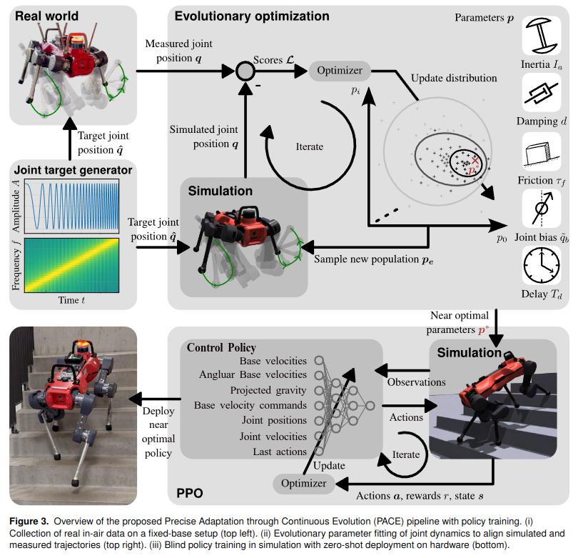

PACE 프레임워크는 **"데이터 수집 $\rightarrow$ 파라미터 식별 $\rightarrow$ 강화학습"**으로 이어지는 3단계 파이프라인으로 구성됩니다. 각 단계는 불확실성을 배제하고 물리적 정합성을 극대화하도록 설계되었습니다.

## Data Collection: 현실의 데이터 확보

시뮬레이터를 현실과 맞추기 위해서는 먼저 현실 로봇의 정확한 거동 데이터가 필요합니다. 저자들은 복잡한 접촉 역학(Contact Dynamics)이 섞이는 것을 방지하기 위해 **무접촉(In-air)** 상태에서 데이터를 수집합니다.

### 실험 셋업 (Experimental Setup)
* **고정된 베이스 (Fixed Base)**: 로봇의 몸체를 공중에 단단히 고정합니다. 이는 베이스의 움직임으로 인한 관성력이나 코리올리 힘이 관절 간 상호작용(Cross-coupling)을 일으키는 것을 막기 위함입니다.
* **무접촉 (No Contacts)**: 다리가 지면에 닿지 않게 하여, 측정하기 힘든 지면 반력(GRF)이나 마찰의 영향을 원천 차단합니다. 특히 로봇이 서 있을 때(Stance)는 베이스의 거대한 관성이 구동기 관성을 덮어버리기 때문에(Dominate), 구동기 자체의 특성을 보려면 공중에 띄우는 것이 필수적입니다. 

### 핵심 조건 (Key Conditions)
단순히 로봇을 흔드는 것이 아니라, 시스템 식별(System ID)에 최적화된 데이터를 얻기 위해 다음 조건들을 준수합니다.

* **Chirp 신호 가진 (Excitation)**:
    * 주파수가 점진적으로 변하는 **Chirp 신호**를 사용하여, 저주파 대역부터 고주파 대역까지 빠짐없이 시스템을 자극합니다. 즉 로봇의 관절을 천천히 크게 움직이는것 부터, 빠르게 떨듯이 움직이는것까지 모든 궤적을 만들어 command를 생성합니다. 논문에서는 20~60초동안 이 범위(0.1Hz ~10Hz)를 스윕하며 데이터를 모읍니다.
    * **대역폭(Bandwidth)**: 이상적으로는 제어 정책(Policy)이 낼 수 있는 최대 주파수인 나이퀴스트 주파수($f_{policy}/2$)까지, 혹은 실제 보행 시 발생할 주파수의 최소 2배까지 가진합니다.
* **낮은 PD 게인 (Low Joint-level PD Gains)**:
    * 평소처럼 높은 PD 게인을 쓰면 제어 루프가 너무 단단해져서(Stiff), 관성($I_a$)이나 댐핑($d$) 같은 물리적 특성이 겉으로 드러나지 않습니다.
    * 일부러 **게인을 낮춰서(Soft)** 시스템의 고유 거동이 잘 나타나도록 유도합니다. 이를 통해 관절의 무게감이나 마찰 특성을 데이터 상에서 명확히 분리해낼 수 있습니다.

## Parameter Identification: 시뮬레이터 튜닝

수집된 데이터를 바탕으로 시뮬레이터가 현실과 똑같이 움직이도록 파라미터를 최적화(Fitting)하는 과정입니다.

### 식별 대상 파라미터 ($p$)
복잡한 물리 엔진 전체를 건드리는 대신, 관절 동역학을 지배하는 **최소한의 파라미터 5개**만을 식별합니다. ($n$은 관절 개수)

$$
p = [I_a, d, \tau_f, \tilde{q}_b, T_d] \in \mathbb{R}^{4n+1}
$$

1.  **$I_a$ (Armature Inertia)**: 구동기(로터+기어박스)의 유효 관성
2.  **$d$ (Viscous Damping)**: 속도에 비례하는 점성 마찰
3.  **$\tau_f$ (Coulomb Friction)**: 일정한 크기의 쿨롱 마찰
4.  **$\tilde{q}_b$ (Joint Bias)**: 관절 센서의 영점 오차 (Offset)
5.  **$T_d$ (Global Delay)**: 통신 및 제어 지연 시간 (시스템 전체 공통)

### 최적화 과정 (Evolutionary Optimization)
* **알고리즘**: 미분이 불가능한 시뮬레이션 환경에서도 강건하게 해를 찾을 수 있는 **CMA-ES (Covariance Matrix Adaptation Evolution Strategy)**를 사용합니다.
* **병렬 시뮬레이션**: $N=4096$개의 환경을 동시에 띄우고, 실제 로봇에 인가했던 타겟 명령($\hat{q}$)을 그대로 입력합니다.
* **손실 함수 (Loss)**: 실제 로봇의 관절 궤적($q^{real}$)과 시뮬레이션 궤적($q^{sim}$) 간의 **MSE(평균 제곱 오차)**를 최소화합니다. 

### 식별 불가능성 (Identifiability)과 PD 게인 고정
저자들은 시스템 식별 시 **PD 게인($P_{\tau}, D_{\tau}$)은 최적화하지 않고 고정**합니다.

$$
u \cdot I_a \ddot{q} \approx u \cdot P_{\tau} \Delta q
$$

위 식에서 볼 수 있듯이, 관성($I_a$)과 PD 게인($P_{\tau}$)을 동시에 추정하려 하면, 두 값의 **'비율'**만 맞으면 되는 무수히 많은 해(Non-unique solutions)가 존재하게 됩니다. 따라서 우리가 확실히 알고 있는 값인 PD 게인은 하드웨어 세팅값으로 고정하고, 모르는 값인 물리 파라미터만 찾아내어 유일한 해를 보장합니다.

## Learning Environment: 강화학습 설정

정확해진 시뮬레이터 덕분에, PACE는 **동역학 랜덤화(Dynamics Randomization)를 전혀 사용하지 않고** 강화학습을 수행합니다. 

### 관측 및 행동 (Observation & Action)
* **비대칭 Actor-Critic**:
    * **Actor (Policy)**: 로봇 내부 센서 정보(Proprioception)만 받는 **'Blind Policy'**입니다. 노이즈가 포함된 관절 정보 등을 사용합니다.
    * **Critic**: 지형 높이 맵(Height scan), 마찰 계수 등 시뮬레이터의 **'Privileged Info'**를 모두 봅니다.
* **Safe PD Control**: 관절 한계(Joint Limit) 근처에서는 더 나아가는 명령을 무시하고(0으로 포화), 돌아오는 명령만 허용하는 안전장치를 시뮬레이션과 실제 로봇 모두에 적용하여 하드웨어를 보호합니다. 

### 보상 함수 (Rewards)와 에너지 모델
복잡한 튜닝 없이 **단 4개의 항(속도 추종, 충돌, 발 착지, 에너지)**만 사용합니다. 특히 **에너지(Energy)** 항은 단순한 $\tau^2$ 최소화가 아닌, PMSM 모터의 물리를 반영한 정교한 모델을 사용합니다. 

$$
P_{total} = P_{el} + P_{mech} + P_{pot}
$$

1.  **$P_{el}$ (전기적 손실)**: 모터 코일 저항($R$)과 전류($i_q$)에 의한 **줄 발열(Joule Heating)**. 토크 기반으로 변환하여 계산합니다.
    $$P_{el} \propto \sum \tau^2 \frac{R}{r^2 k_i^2}$$
2.  **$P_{mech}$ (기계적 일률)**: 모터가 실제로 수행한 일. **회생 제동(Regeneration)** 효율($k_{regen}$)까지 고려하여, 배터리로 회수되는 에너지는 차감합니다.
3.  **$P_{pot}$ (위치 에너지)**: 로봇 링크들의 위치 에너지 변화율. 이를 통해 로봇이 에너지를 아끼려 주저앉는 것을 방지합니다.

이러한 물리 기반 보상은 로봇이 기구학적으로 유리한 자세를 취하고, 저항이 큰 모터 사용을 줄이는 등 **실질적인 에너지 효율**을 학습하게 만듭니다.

# Experiments & Results
## 정밀한 시스템 식별 및 모델 정확도 (In-air Identification)

가장 먼저 확인해야 할 것은 "과연 시뮬레이터가 현실과 똑같이 움직이는가?"입니다.

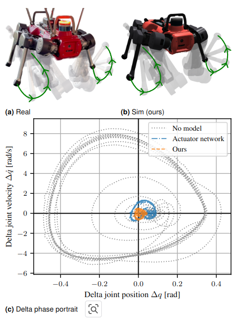 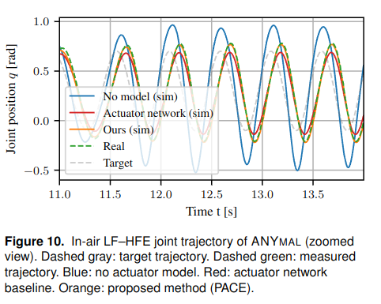

### **Figure 1 & Figure 10: 기준 모델 대비 압도적인 정확도**
* **비교 대상**: (1) 모델 없음(URDF Only), (2) 기존 SOTA (Actuator Network), (3) PACE (Ours).
* **결과 분석 (Figure 1c, 7d)**:
    * **Delta Phase Portrait**: 시뮬레이션과 현실의 오차($\Delta q, \Delta \dot{q}$)를 점으로 찍었을 때, **PACE(주황색)**는 점들이 (0, 0) 원점 근처에 매우 조밀하게 모여 있습니다.
    * **반면**, Actuator Network(파란색)는 원점 주변으로 퍼져 있고 편향(Bias, 약 5도)이 관찰되며, 모델 없음(회색)은 아예 큰 궤적을 그리며 빗나갑니다.
* **효과**: PACE는 블랙박스 신경망(Actuator Net)보다 더 적은 데이터(20초)를 쓰면서도, 물리적인 편향 없이 현실을 더 정밀하게 모사했습니다.

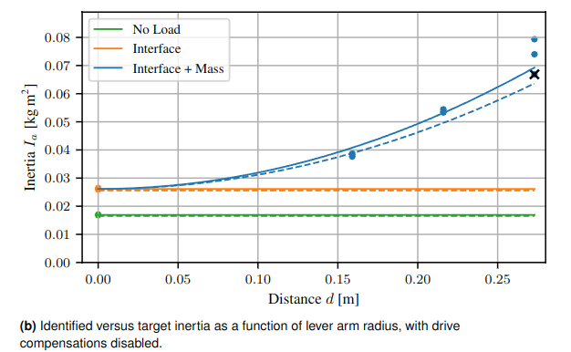 

### **Figure 5b & 17: 물리적 정합성 입증**
* **실험**: 단일 구동기에 무게추(Mass)를 달아가며 관성($I_a$)을 식별했습니다.
* **결과 분석**: 무게추를 늘릴수록 PACE가 식별한 관성값($I_a$)이 이론적인 물리 법칙(이차곡선)을 따라 정확하게 증가합니다. 
* **효과**: PACE가 단순히 데이터만 외우는 것이 아니라, **실제 물리량(관성, 마찰 등)을 정확히 찾아내고 있음**을 증명합니다. 이는 학습된 모델이 새로운 동작(Unseen Trajectory)이나 다른 게인(Gain) 설정에서도 잘 작동하는 이유입니다. 

---

## Sim-to-Real 보행 성능 및 추종력 (Tracking Performance)

식별된 모델로 학습한 정책이 실제 땅 위에서 얼마나 잘 걷는지 확인한 결과입니다.

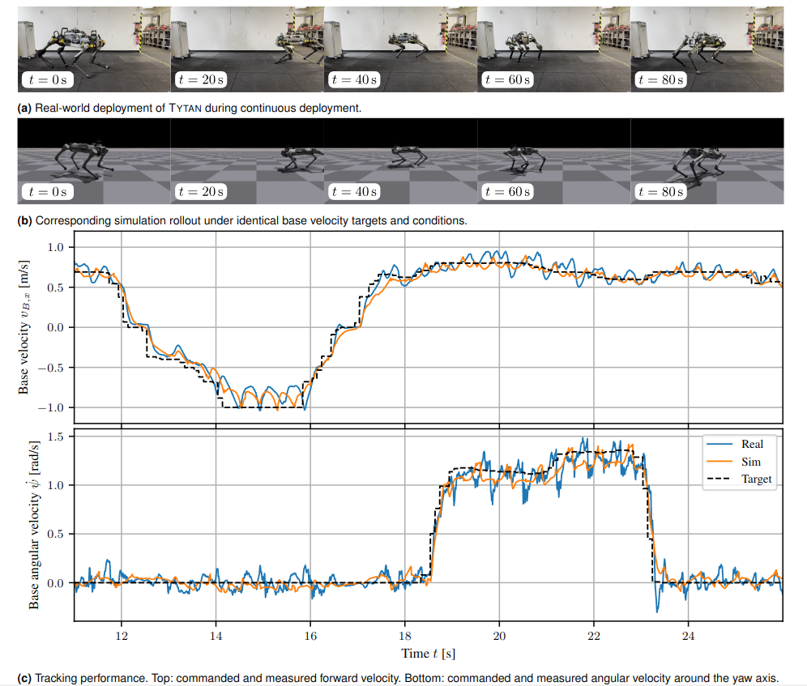 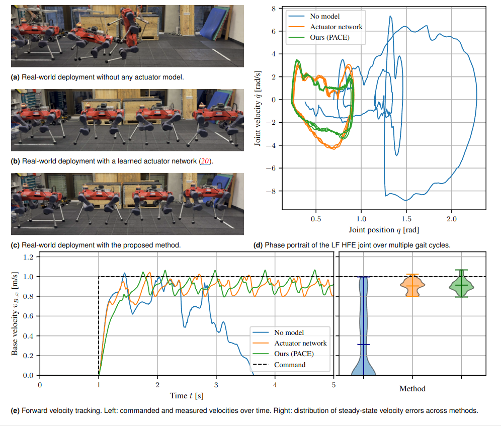

### **Figure 6 (TYTAN) & Figure 7 (ANYmal): 제로샷(Zero-shot) 배포 성공**
* **TYTAN (Figure 6)**:
    * 사용자의 속도 명령(점선)에 대해 실제 로봇(파란선)과 시뮬레이션(주황선)이 거의 완벽하게 일치합니다.
    * 특히 전진 속도($v_x$)뿐만 아니라 회전 속도($\dot{\psi}$) 추종 능력도 매우 뛰어납니다. 
* **ANYmal (Figure 7)**:
    * **No Model**: 크레인에 걸려 넘어지며 보행에 실패합니다. [cite: 753]
    * **PACE**: 기존 SOTA인 Actuator Network와 대등하거나 더 우수한 보행 성능을 보여줍니다. 정상 상태(Steady-state)에서의 속도 오차 분포(Violin plot)가 매우 좁고 안정적입니다.

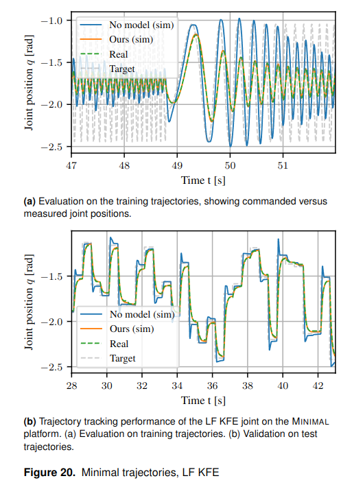

### **Figure 20 & 21: 다양한 로봇 및 동작 검증**
* 소형 로봇 **MINIMAL**에서도 훈련 궤적과 테스트 궤적 모두에서 시뮬레이션과 현실이 일치했습니다. 
* ANYmal의 횡이동(Sideways)과 제자리 회전(Yaw) 같은 복잡한 동작에서도 목표 속도를 정확히 추종했습니다.

---

## 획기적인 에너지 효율 향상 (Energetic Efficiency)

이 논문의 가장 강력한 성과 중 하나입니다. 물리 기반 에너지 보상을 사용한 효과가 데이터로 드러납니다.

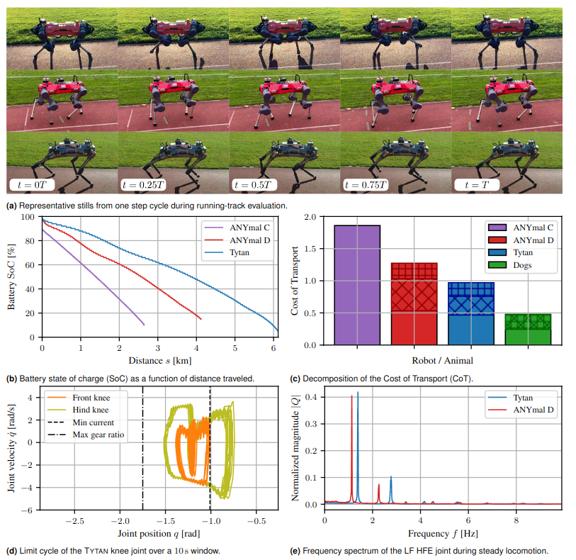 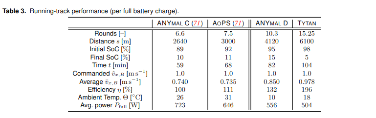 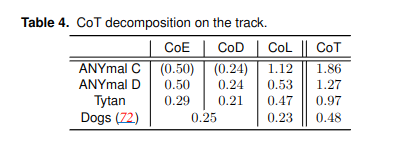

### **Figure 8 & Table 3, 4: COT (Cost of Transport) 감소**
* **실험**: 400m 육상 트랙을 배터리가 다 닳을 때까지 달리게 하여 에너지 효율을 측정했습니다.
* **결과 분석 (Table 4)**:
    * **ANYmal C (기존 SOTA)**: COT **1.86**
    * **ANYmal D (PACE 적용)**: COT **1.27**
    * **효과**: 이동 에너지 비용(COT)을 **약 32% 감소**시켰습니다. 
    * **원인 분석**: 정확한 모델링 덕분에 로봇이 **다리를 더 펴고(Straight-leg) 걷는 보행**을 학습할 수 있었습니다. 무릎을 굽히고 걸으면 토크가 많이 들어 에너지를 낭비하는데, PACE는 다리를 펴도 시뮬레이션이 불안정해지지 않기 때문에 효율적인 자세를 찾을 수 있었던 것입니다.

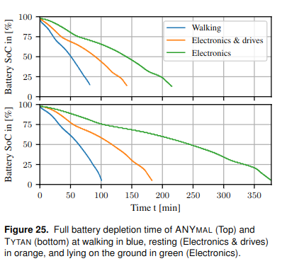

### **Figure 25: 배터리 지속 시간**
* **TYTAN**: 한 번 충전으로 **6.1km**를 보행하며 104분간 작동했습니다. 
* **ANYmal D**: **4.12km**를 보행하며 82분간 작동했습니다. 이는 기존 제어기보다 월등히 긴 거리입니다.

---

## 동적 한계 돌파 (Dynamic Limits)

단순한 걷기를 넘어, 하드웨어의 한계까지 밀어붙이는 고난도 동작 수행 능력입니다.

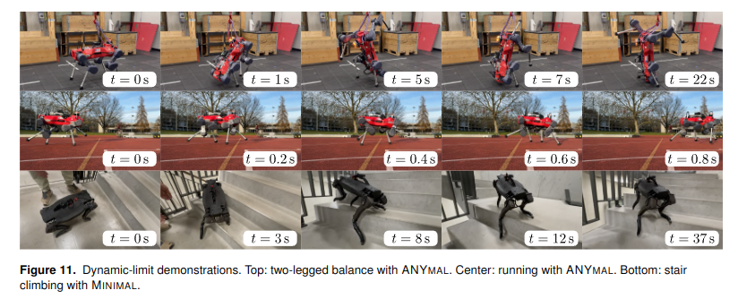 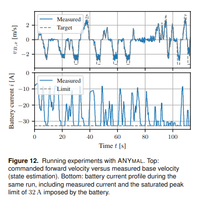

### **Figure 11 & 12: 하드웨어 리미트 도달**
* **고속 주행 (Running)**: ANYmal 로봇으로 **3m/s**의 달리기 속도를 기록했습니다. 
    * **Figure 12**를 보면, 속도가 3m/s에 도달했을 때 배터리 전류가 한계치인 **32A(빨간 점선)**에 도달하여 포화(Saturation)되는 것을 볼 수 있습니다. 
    * **의미**: 제어기의 성능 부족이 아니라, **배터리 출력의 한계** 때문에 더 못 달린 것입니다. 즉, PACE 제어기는 하드웨어 성능을 끝까지 뽑아냈습니다.
* **이족 균형 (Two-legged Balance)**: 사족 보행 로봇으로 두 다리로만 서서 균형을 잡는 고난도 제어에 성공했습니다. 
* **계단 오르기**: 4kg짜리 소형 로봇(MINIMAL)으로 일반적인 크기의 계단을 연속으로 오르는 데 성공했습니다. 
