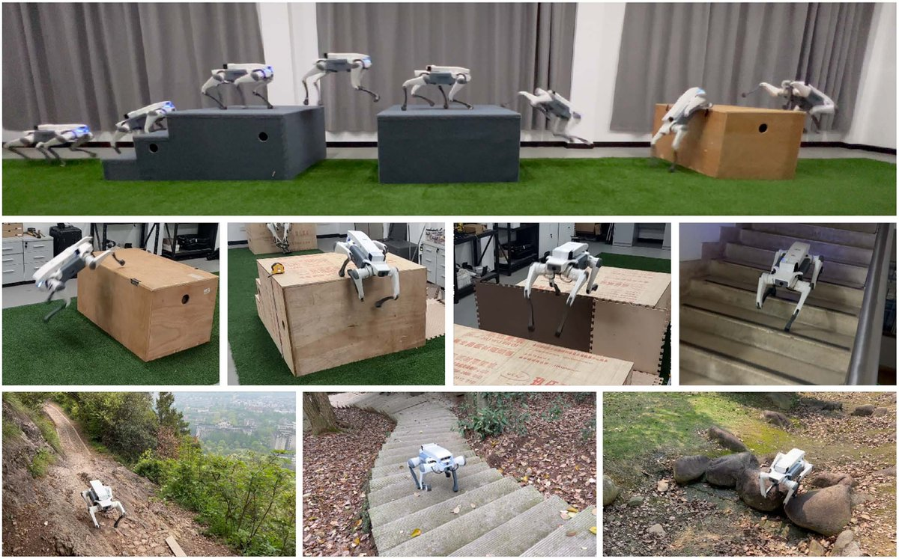
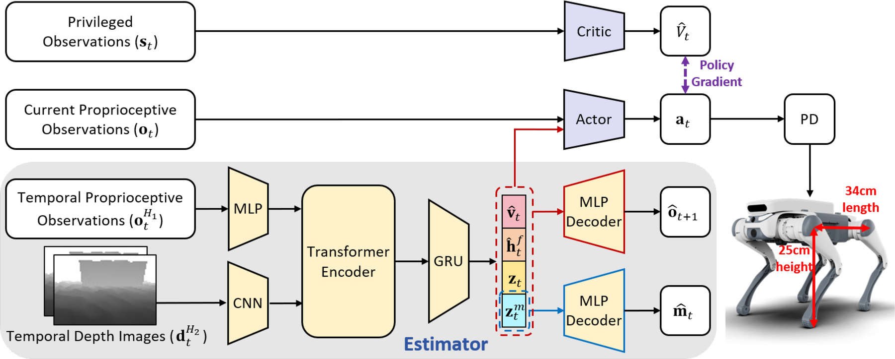
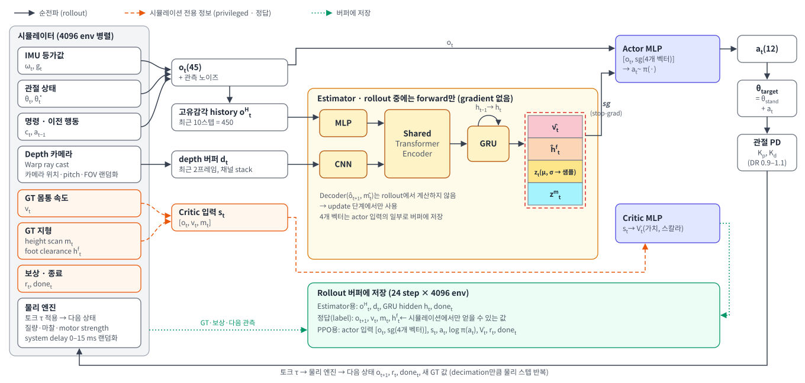
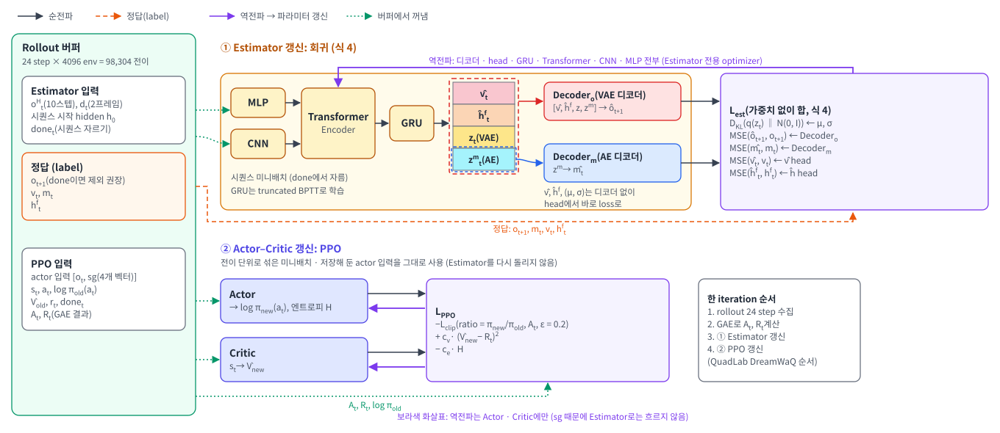
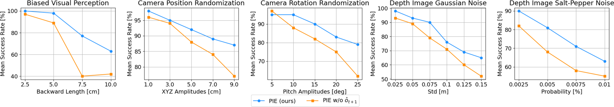
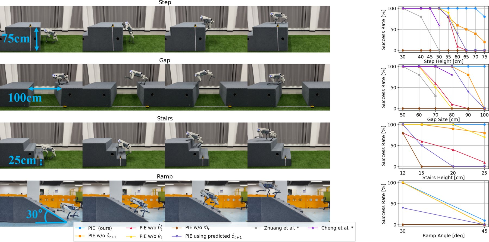
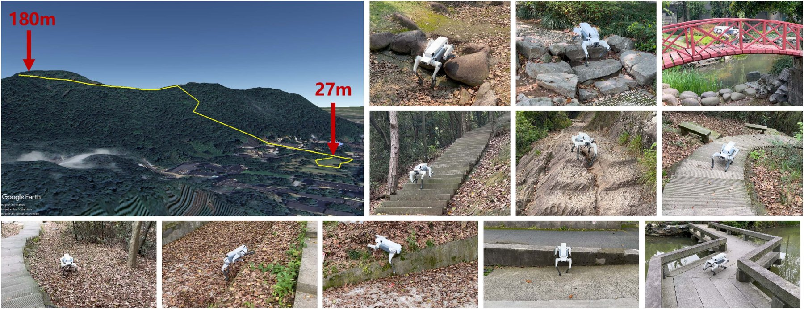
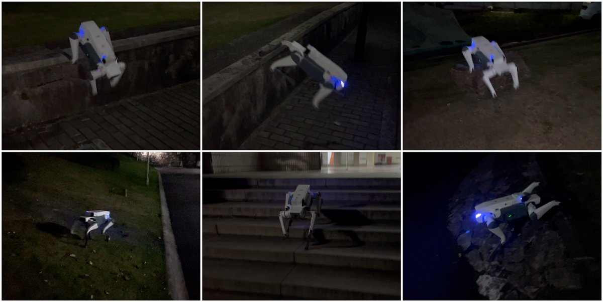
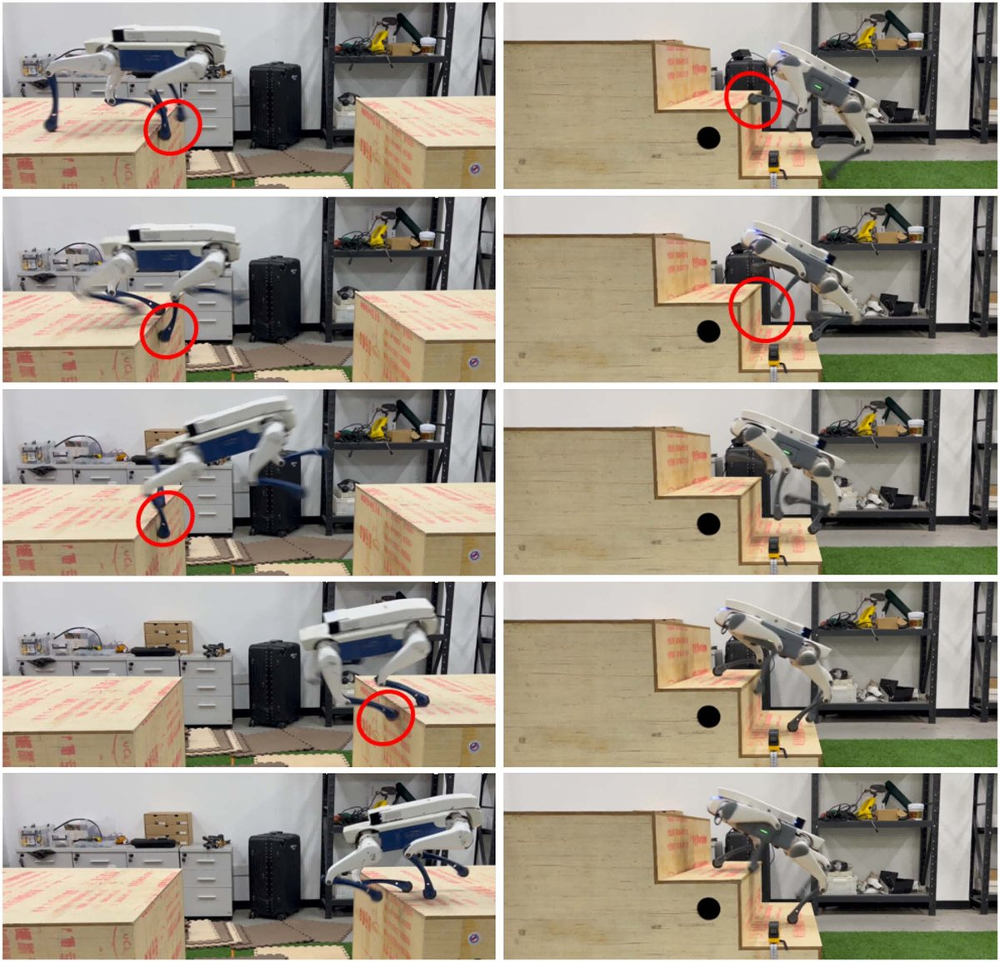

::: {.callout-note title="🔗 Links"}
- [📄 Paper (arXiv)](https://arxiv.org/abs/2408.13740)
- [📄 IEEE RA-L (DOI)](https://doi.org/10.1109/LRA.2024.3459797)
- 📦 Code: 공개되지 않음 (2026-10 기준, arXiv와 논문 본문 모두 코드 링크 없음)
:::

::: callout-note
PIE: Parkour with Implicit-Explicit Learning Framework for Legged Robots (Luo et al., IEEE RA-L 2024)
:::

본 포스트는 PIE의 **전체 학습 프레임워크**를 분석합니다. 특히 각 관측값이 **어떤 센서에서 오는지**, Estimator가 state를 **어떻게 가공해서 Policy에 넣는지**, 그리고 Teacher–Student 없이 **one-stage로 학습하는 구조**를 개발 관점에서 정리합니다. 학습 원리(PPO, VAE의 수학적 배경)는 다음 포스트에서 다룹니다.

::: {.callout-tip title="한눈에 보기"}
1. **One-stage 학습**: Teacher–Student를 쓰지 않습니다. Asymmetric actor-critic(PPO)과 Estimator(회귀)를 **동시에** 학습합니다.
2. **Actor 입력** = 고유감각 관측 $\mathbf{o}_t$(45차원) + Estimator 출력 4종 $[\hat{\mathbf{v}}_t, \hat{\mathbf{h}}^f_t, \mathbf{z}_t, \mathbf{z}^m_t]$.
3. **Estimator** = depth 2프레임(CNN) + 고유감각 10스텝(MLP) → Transformer(cross-modal) → GRU(기억) → 4개 벡터.
4. **Dual-level**: 이해 방식(지형의 explicit 복원 vs 다음 상태의 implicit 예측) × 표현 방식(latent vs 물리량).
5. **생성모델 요소**: $\mathbf{z}_t$는 VAE latent(KL로 $\mathcal{N}(0, I)$에 정렬), $\mathbf{z}^m_t$는 height map을 복원하는 autoencoder latent입니다.
6. **학습 비용**: Isaac Gym 4096 env, 10,000 iteration을 RTX 4090에서 20시간 이내.
:::

# 배경 및 문제 정의



Parkour는 달리기, 점프, 기어오르기를 섞어 장애물을 빠르게 통과하는 과제입니다. 로봇에게는 빠른 속도에서의 균형 유지, 바뀌는 지형에 대한 실시간 인지, 정밀한 동작 조정이 동시에 필요합니다.

Blind locomotion(고유감각만 사용)은 지형을 **밟아 본 뒤에야** 암묵적으로 추론할 수 있습니다. 높은 단차나 넓은 gap처럼 **미리 힘을 모아야 하는** 동작에는 depth camera, LiDAR 같은 외부 센서가 필요합니다. 저자들은 기존 parkour 연구의 한계를 세 가지로 정리합니다.

-   **외부 센서의 지연과 노이즈**: 실시간으로 정밀한 지형 추정이 어렵고, 특히 발이 자주 걸리는 **모서리(edge)**에서 치명적입니다.
-   **2단계(Two-stage) 학습**: Teacher를 모방하는 단계에서 정보 손실이 생기고 학습 과정이 복잡해집니다.
-   **여러 동작의 통합**: 단순한 학습 과정과 보상 함수로 여러 parkour 동작을 하나의 네트워크에 담기 어렵습니다.

| 기존 연구 | 구조 | PIE 저자가 지적한 한계 |
| :--- | :--- | :--- |
| Hoeller et al. (ANYmal parkour) | 계층형: 인지 → navigation → locomotion | 비정형 지형에서 occupancy voxel 오류, 높은 학습 비용, 낮은 확장성 |
| Zhuang et al. (Robot Parkour Learning) | 다단계, soft/hard constraint, depth student | privileged 정보가 시뮬레이션 장애물의 기하 형상에 강하게 묶임 |
| Cheng et al. (Extreme Parkour) | Teacher–Student, teacher 입력에 waypoint | waypoint를 지형마다 사람이 지정 |
| Agarwal et al. | Teacher–Student, depth → 관절각 | 2단계 모방 과정의 정보 손실 |

> **PIE의 접근**:
> "Teacher를 따라 하게 하지 말고, **하나의 정책이 처음부터 implicit 추정과 explicit 추정을 함께** 배우게 하자"

## Contribution

-   **Dual-level implicit-explicit estimation**을 쓰는 one-stage parkour 학습 프레임워크.
-   로봇 높이의 3배 단차(0.75 m) 오르내리기, 로봇 길이의 3배 gap(1 m), 로봇 높이만 한 계단(0.25 m).
-   별도 fine-tuning 없이 실내와 실외 모두에서 zero-shot sim-to-real.

# 하드웨어와 센서 구성

PIE를 이해하는 출발점으로, 각 관측값이 어떤 센서에서 오는지 먼저 정리합니다.

| 항목 | 내용 |
| :--- | :--- |
| 로봇 | DEEP Robotics Lite3 (12 DoF, 12.7 kg) |
| 크기 | 서 있을 때 thigh 관절 높이 25 cm, 앞뒤 thigh 관절 사이 거리 34 cm |
| 무릎 최대 토크 | 30.5 Nm |
| Depth 카메라 | Intel RealSense D435i 한 대 (onboard, 전방 egocentric), raw depth **10 Hz** |
| 연산 장치 | Rockchip RK3588. 이미지 후처리와 네트워크 추론을 모두 onboard에서 수행 |
| 제어 주기 | 관절 action **50 Hz** |
| 비교 기준 로봇 | Unitree A1 (thigh 높이 26 cm, 거리 40 cm, 12 kg, 무릎 33.5 Nm). 크기가 비슷해 기존 연구와 상대 비교 가능 |

| 센서 | 측정값 | 쓰이는 곳 |
| :--- | :--- | :--- |
| IMU | 몸통 각속도 $\boldsymbol{\omega}_t$, body frame 중력 방향 $\mathbf{g}_t$ | $\mathbf{o}_t$ (Actor, Critic, Estimator history) |
| 관절 엔코더 | 관절각 $\boldsymbol{\theta}_t$, 관절 각속도 $\dot{\boldsymbol{\theta}}_t$ | $\mathbf{o}_t$ |
| 정책 자신 | 이전 행동 $\mathbf{a}_{t-1}$ | $\mathbf{o}_t$ |
| 조작자 | 속도 명령 $\mathbf{c}_t$ | $\mathbf{o}_t$ |
| RealSense D435i | depth 이미지 | Estimator 입력 $\mathbf{d}_t$ (2프레임) |
| **시뮬레이션 전용** | 실제 몸통 속도 $\mathbf{v}_t$, height map $\mathbf{m}_t$, foot clearance $\mathbf{h}^f_t$, 다음 관측 $\mathbf{o}_{t+1}$ | Critic 입력, Estimator 정답(label) |

::: {.callout-note}
### Depth 10 Hz와 제어 50 Hz의 차이
Depth는 10 Hz, 제어는 50 Hz이므로 depth 한 프레임이 제어 5스텝에 걸쳐 쓰이는 구조로 보입니다. 다만 논문은 이 비동기 처리 방법(최신 프레임 재사용인지, 시뮬레이션에서도 같은 주기로 depth를 갱신하는지)을 설명하지 않습니다. 시뮬레이션에서는 도메인 랜덤화 항목 중 **system delay 0–15 ms**와 **카메라 위치·pitch·FOV 랜덤화**로 실기 depth의 불확실성을 흉내 냅니다.
:::

# 전체 프레임워크



PIE는 세 개의 하위 네트워크로 구성됩니다.

-   **Actor**: 배포 시 실제로 얻을 수 있는 정보(고유감각 + Estimator 출력)만 받아 행동 $\mathbf{a}_t$를 냅니다.
-   **Critic**: 고유감각에 privileged 정보(실제 속도, height map)를 더해 가치 $\hat{V}_t$를 냅니다.
-   **Estimator**: depth 이미지와 고유감각 history에서 로봇 상태와 주변 지형을 추정합니다.

최적화는 **두 부분이 동시에** 진행됩니다. Actor-Critic은 PPO로, Estimator는 식 (4)의 회귀 loss로 학습합니다.

Fig. 2에서 놓치기 쉬운 디테일이 두 가지 있습니다.

-   **빨간 점선 상자**는 $\hat{\mathbf{v}}_t, \hat{\mathbf{h}}^f_t, \mathbf{z}_t, \mathbf{z}^m_t$ **4개 모두**를 감쌉니다. 이 4개가 Actor로 들어가고, 동시에 빨간 MLP Decoder로 들어가 $\hat{\mathbf{o}}_{t+1}$을 복원합니다.
-   **파란 점선 상자**는 $\mathbf{z}^m_t$**만** 감쌉니다. 파란 MLP Decoder는 $\mathbf{z}^m_t$만으로 height map $\hat{\mathbf{m}}_t$를 복원합니다.

배포 시의 데이터 흐름을 센서부터 관절 PD까지 다시 그리면 다음과 같습니다. 학습 시의 흐름은 뒤의 "학습 단계 설계" 절에서 따로 다룹니다.

```{mermaid}
flowchart TD
  subgraph SENSE["센서 (실기)"]
    direction LR
    IMU["IMU<br/>ω_t, g_t"]
    ENC["관절 엔코더<br/>θ_t, θ̇_t"]
    CMD["속도 명령 c_t"]
    PREV["이전 행동 a_t-1"]
    CAM["D435i depth<br/>10 Hz"]
  end
  IMU --> OT
  ENC --> OT
  CMD --> OT
  PREV --> OT
  OT["o_t (45)"] --> HIST["고유감각 history 10스텝"]
  CAM --> DH["depth 2프레임 (채널 stack)"]
  subgraph EST["Estimator"]
    HIST --> MLP["MLP"]
    DH --> CNN["CNN"]
    MLP --> TF["Shared Transformer Encoder"]
    CNN --> TF
    TF --> GRU["GRU (기억)"]
    GRU --> VEC["v̂_t · ĥ_t^f · z_t · z_t^m"]
  end
  OT --> ACT["Actor MLP"]
  VEC --> ACT
  ACT --> A["a_t (12)"]
  A --> PD["θ_target = θ_stand + a_t → 관절 PD"]
  style SENSE fill:#f6f8fa,stroke:#c9d1d9,color:#24292f
  style EST fill:#eef4fb,stroke:#9fb3c8,color:#24292f
```

# 관측(State) 구성

## Actor 입력

Actor가 직접 받는 고유감각 관측 $\mathbf{o}_t$는 관절 엔코더와 IMU에서 바로 측정되는 45차원 벡터입니다.

$$
\mathbf{o}_t = \begin{bmatrix} \boldsymbol{\omega}_t & \mathbf{g}_t & \mathbf{c}_t & \boldsymbol{\theta}_t & \dot{\boldsymbol{\theta}}_t & \mathbf{a}_{t-1} \end{bmatrix}^T \tag{1}
$$

| 항목 | 기호 | 차원 | 출처 |
| :--- | :--- | ---: | :--- |
| 몸통 각속도 | $\boldsymbol{\omega}_t$ | 3 | IMU 자이로 |
| body frame 중력 방향 | $\mathbf{g}_t$ | 3 | IMU 자세 추정 |
| 속도 명령 | $\mathbf{c}_t$ | 3 | 조작자 ($v_x, v_y, \omega_{yaw}$로 추정) |
| 관절각 | $\boldsymbol{\theta}_t$ | 12 | 관절 엔코더 |
| 관절 각속도 | $\dot{\boldsymbol{\theta}}_t$ | 12 | 관절 엔코더 |
| 이전 행동 | $\mathbf{a}_{t-1}$ | 12 | 정책 출력 |
| **합계** | | **45** | 명령 3차원은 45에서 나머지를 뺀 계산값 |

Policy 네트워크의 최종 입력은 $\mathbf{o}_t$에 Estimator 출력 4개를 이어 붙인 벡터입니다.

$$
\pi\left(\mathbf{a}_t \mid \mathbf{o}_t,\ \hat{\mathbf{v}}_t,\ \hat{\mathbf{h}}^f_t,\ \mathbf{z}^m_t,\ \mathbf{z}_t\right)
$$

몸통 선속도는 Actor에 **직접 들어가지 않습니다**. 실기에서 선속도를 정확히 측정할 센서가 없으므로 Estimator가 추정한 $\hat{\mathbf{v}}_t$를 대신 씁니다.

## Critic 입력

$$
\mathbf{s}_t = \begin{bmatrix} \mathbf{o}_t & \mathbf{v}_t & \mathbf{m}_t \end{bmatrix}^T \tag{2}
$$

-   $\mathbf{v}_t$: 시뮬레이션의 **실제** 몸통 속도.
-   $\mathbf{m}_t$: 시뮬레이션의 **실제** height map scan dots (로봇 주변 지형 높이 샘플).
-   Critic은 depth 이미지와 Estimator 출력을 쓰지 않습니다 (식 (2) 기준).

## Estimator 입력

-   **Depth history** $\mathbf{d}_t$: 최근 depth 이미지 **2프레임**을 채널 방향으로 쌓은 텐서.
-   **고유감각 history** $\mathbf{o}^{H}_t$: 최근 **10스텝**의 $\mathbf{o}_t$를 이어 붙인 벡터 (45 × 10 = 450차원, 계산값).

::: {.callout-warning}
### 원문 표기 불일치
본문은 "depth를 $\mathbf{d}^{H_1}_t$, 고유감각을 $\mathbf{o}^{H_2}_t$로 쓰고 $H_1 = 2$, $H_2 = 10$"이라고 설명합니다. 그런데 Fig. 2와 식 (4)는 위첨자를 반대로($\mathbf{o}^{H_1}_t$, $\mathbf{d}^{H_2}_t$) 표기합니다. 본 포스트는 본문 설명을 따라 **depth 2프레임, 고유감각 10스텝**으로 정리했습니다.
:::

## 원문에 없는 차원 정보

논문은 아래 항목의 크기를 밝히지 않습니다. 구현할 때 출발점으로 쓸 수 있는 값을 함께 적었지만, **PIE 원문의 값이 아닙니다**.

| 항목 | 원문 | 구현 출발점 (근거) |
| :--- | :--- | :--- |
| Depth 해상도 | 미기재 | 58 × 87 정도로 축소 (Extreme Parkour 관례) |
| Height map $\mathbf{m}_t$ 점 수 | 미기재 | 187 = 17 × 11 (QuadLab critic의 기존 height scan) |
| $\mathbf{z}_t$ 차원 | 미기재 | 16 (DreamWaQ, QuadLab `cenet.py`) |
| $\mathbf{z}^m_t$ 차원 | 미기재 | 정해진 근거 없음. 16–32 범위에서 실험 |
| $\hat{\mathbf{h}}^f_t$ 차원 | 미기재 | 4 (발마다 1개로 추정) |
| $\hat{\mathbf{v}}_t$ 차원 | 미기재 | 3 (몸통 선속도) |
| CNN, Transformer, GRU 크기 | 미기재 | 소규모로 시작 |
| PPO 하이퍼파라미터 | 미기재 | QuadLab 기존 PPO 설정 재사용 |

# Estimator: state 가공 흐름 (Step-by-Step)

## [Step 1] 시계열 입력 쌓기

::: {.callout-note}
### 핵심 직관
"한 장의 사진과 한 순간의 감각으로는 부족하니, 짧은 과거를 함께 보자."
:::

-   Depth: 최근 2프레임을 **채널 방향**으로 쌓아 $(B, 2, H, W)$ 텐서를 만듭니다. 두 프레임의 차이에서 움직임 정보를 얻을 수 있습니다.
-   고유감각: 최근 10스텝을 이어 붙여 $(B, 450)$ 벡터를 만듭니다.

## [Step 2] Modality별 인코딩

-   **CNN**: depth 텐서에서 2D depth feature map을 뽑습니다. Feature map의 공간 위치 하나하나가 **visual token**이 됩니다.
-   **MLP**: 고유감각 history에서 proprioceptive feature를 뽑습니다.

## [Step 3] Shared Transformer Encoder (cross-modal attention)

::: {.callout-note}
### 핵심 직관
"보이는 것(depth)과 느끼는 것(고유감각)을 서로 대조하게 하자."
:::

Visual token들과 고유감각 feature를 **하나의 transformer encoder**에 함께 넣습니다. Self-attention 안에서 각 visual token은 고유감각 feature를 참고하고, 고유감각 feature도 visual token들을 참고합니다. 저자들은 이를 두 modality 사이의 **cross-modal reasoning**이라고 설명합니다. 비슷한 구조는 Yang et al.의 cross-modal transformer(원문 [11])에서 쓰였습니다.

## [Step 4] GRU (기억)

전방 카메라 한 대로는 **몸 아래와 뒤의 지형**을 볼 수 없습니다. 그래서 transformer를 거친 depth feature와 고유감각 feature를 이어 붙여 **GRU**에 넣고, 지나온 지형과 상태를 기억하게 합니다. 예를 들어 앞발이 이미 지나간 모서리의 위치는 지금 카메라에 보이지 않아도 GRU의 hidden state에 남아 있어야 뒷발이 그 모서리를 처리할 수 있습니다.

## [Step 5] 4개의 추정 벡터

GRU 출력에서 Policy 입력이 될 4개의 벡터를 만듭니다.

| 벡터 | 종류 | 의미 |
| :--- | :--- | :--- |
| $\hat{\mathbf{v}}_t$ | 물리량 (explicit) | 몸통 선속도 추정값 |
| $\hat{\mathbf{h}}^f_t$ | 물리량 (explicit) | 발과 지형 사이 높이(foot clearance) 추정값 |
| $\mathbf{z}^m_t$ | latent (autoencoder) | 주변 height map의 압축 표현 |
| $\mathbf{z}_t$ | latent (VAE) | 로봇 상태와 주변 환경의 순수 latent |

$\mathbf{z}_t$는 VAE 구조로 만듭니다. GRU 출력에서 평균 $\boldsymbol{\mu}$와 분산 $\boldsymbol{\sigma}^2$를 예측하고 reparameterization으로 샘플링합니다.

$$
\mathbf{z}_t = \boldsymbol{\mu} + \boldsymbol{\sigma} \odot \boldsymbol{\epsilon}, \quad \boldsymbol{\epsilon} \sim \mathcal{N}(0, I)
$$

## [Step 6] Decoder로 복원 (학습 신호)

::: {.callout-important}
### Decoder는 학습용입니다
Decoder 출력($\hat{\mathbf{o}}_{t+1}$, $\hat{\mathbf{m}}_t$)은 Policy에 들어가지 않습니다. 정답과 비교해 loss를 만드는 데만 쓰이므로, 배포할 때는 Estimator의 인코딩 부분과 Actor만 있으면 됩니다. $\hat{\mathbf{m}}_t$는 실기에서 지형 추정이 맞는지 시각화하는 디버깅 용도로 쓸 수 있습니다.
:::

-   **Successor state decoder** (빨간색): $[\hat{\mathbf{v}}_t, \hat{\mathbf{h}}^f_t, \mathbf{z}_t, \mathbf{z}^m_t] \rightarrow \hat{\mathbf{o}}_{t+1}$. 다음 스텝의 고유감각 관측을 예측합니다.
-   **Height map decoder** (파란색): $\mathbf{z}^m_t \rightarrow \hat{\mathbf{m}}_t$. 주변 height map을 복원합니다.

## [Step 7] Policy 출력과 PD 제어

Action $\mathbf{a}_t$는 12개 관절에 대한 12차원 벡터이고, 서 있는 기본자세 $\boldsymbol{\theta}_{stand}$에 더해져 관절 목표각이 됩니다.

$$
\boldsymbol{\theta}_{target} = \boldsymbol{\theta}_{stand} + \mathbf{a}_t \tag{3}
$$

원문에는 action scale이 따로 없습니다. 목표각은 관절 PD 제어기가 추종하고, PD gain은 도메인 랜덤화($K_p$, $K_d$ factor 0.9–1.1)의 대상입니다.

# Dual-level Implicit-Explicit Estimation

PIE의 이름에 들어간 "implicit-explicit"은 **두 가지 축**에서 정의됩니다.

**Level 1. 로봇과 주변을 어떻게 이해하는가**

-   **Implicit**: 다음 상태 $\mathbf{o}_{t+1}$을 예측하게 해서, 그 예측에 필요한 지형과 동역학 정보를 latent에 스스로 담게 합니다. DreamWaQ, HIM에서 쓰던 방식입니다. Blind 로봇도 할 수 있지만, 지형과 **상호작용한 뒤에야** 추론이 갱신됩니다.
-   **Explicit**: depth로 보이는 지형을 height map $\mathbf{m}_t$로 직접 복원하게 합니다. 미리 볼 수 있지만, depth의 지연과 노이즈 때문에 모서리 근처에서 믿기 어렵습니다.

**Level 2. 추정 결과를 어떤 형태로 표현하는가**

-   **Latent vector** ($\mathbf{z}_t$, $\mathbf{z}^m_t$): Decoder로 복원되는 압축 표현입니다. 압축 과정에서 노이즈 영향이 줄어 강건해집니다.
-   **물리량** ($\hat{\mathbf{v}}_t$, $\hat{\mathbf{h}}^f_t$): 의미가 분명한 값을 직접 추정합니다. 속도는 속도 추종을 우선시하게 하고, foot clearance는 parkour에서 중요한 "발밑 지형"을 직접 알려 줍니다.

|  | Latent (압축 후 복원) | 물리량 (직접 추정) |
| :--- | :--- | :--- |
| **Explicit 이해** (정답 지형·상태 복원) | $\mathbf{z}^m_t \rightarrow \hat{\mathbf{m}}_t$ | $\hat{\mathbf{v}}_t$, $\hat{\mathbf{h}}^f_t$ |
| **Implicit 이해** (다음 상태 예측) | $\mathbf{z}_t$ (+ 나머지 3개) $\rightarrow \hat{\mathbf{o}}_{t+1}$ | – |

::: {.callout-note}
### 왜 둘 다 필요한가
실험(아래 Ablation)에서 explicit만 쓰면(w/o $\hat{\mathbf{o}}_{t+1}$) 시뮬레이션에서는 괜찮지만 실기의 지연과 노이즈에서 성능이 떨어집니다. Implicit만 쓰면(w/o $\hat{\mathbf{m}}_t$) depth에서 쓸모 있는 지형 정보를 뽑지 못해 어려운 지형에서 거의 실패합니다. 저자들은 다음 상태 예측 덕분에 **시각 정보와 고유감각이 충돌할 때 고유감각을 더 믿는** 판단이 가능해진다고 해석합니다.
:::

# 학습 목적 함수

## Estimator Loss

$$
\begin{aligned}
\mathcal{L} = {} & D_{KL}\left(q(\mathbf{z}_t \mid \mathbf{o}^{H}_t, \mathbf{d}_t) \,\|\, p(\mathbf{z}_t)\right) + \text{MSE}(\hat{\mathbf{o}}_{t+1}, \mathbf{o}_{t+1}) \\
& + \text{MSE}(\hat{\mathbf{m}}_t, \mathbf{m}_t) + \text{MSE}(\hat{\mathbf{v}}_t, \mathbf{v}_t) + \text{MSE}(\hat{\mathbf{h}}^f_t, \mathbf{h}^f_t)
\end{aligned} \tag{4}
$$

| 항 | 정답(label) 출처 | 역할 |
| :--- | :--- | :--- |
| $D_{KL}$ | 사전분포 $p(\mathbf{z}_t) = \mathcal{N}(0, I)$ | $\mathbf{z}_t$의 분포를 표준정규분포에 가깝게 정렬 |
| $\text{MSE}(\hat{\mathbf{o}}_{t+1}, \mathbf{o}_{t+1})$ | 다음 스텝에 실제로 관측된 $\mathbf{o}_{t+1}$ | Implicit 추정 (successor state) |
| $\text{MSE}(\hat{\mathbf{m}}_t, \mathbf{m}_t)$ | 시뮬레이션 GT height map | Explicit 지형 추정 |
| $\text{MSE}(\hat{\mathbf{v}}_t, \mathbf{v}_t)$ | 시뮬레이션 GT 몸통 속도 | Explicit 속도 추정 |
| $\text{MSE}(\hat{\mathbf{h}}^f_t, \mathbf{h}^f_t)$ | 시뮬레이션 GT foot clearance | Explicit 발밑 지형 추정 |

식 (4)에는 항별 가중치가 없습니다. 참고로 QuadLab의 DreamWaQ 구현(`cenet.py`)은 `vel_loss + 4.0 * recon_loss + 0.01 * kl_loss`로 가중치를 둡니다.

## VAE 관점 (생성모델 요소)

$\mathbf{z}_t$는 VAE의 latent입니다. KL 항은 가우시안끼리라 닫힌 형태로 계산됩니다.

$$
D_{KL} = -\frac{1}{2} \sum_{j} \left(1 + \log \sigma_j^2 - \mu_j^2 - \sigma_j^2\right)
$$

Ablation "PIE using predicted $\mathbf{o}_{t+1}$"은 $\mathbf{z}_t$ 대신 복원된 $\hat{\mathbf{o}}_{t+1}$을 Policy에 넣은 경우입니다. 이 경우 step과 stairs에서 성능이 크게 떨어집니다. 저자들은 $\mathbf{z}_t$는 표준정규분포라는 사전분포로 정돈되어 있는 반면 $\mathbf{o}_{t+1}$의 분포는 복잡해서 Policy가 정보를 꺼내기 어렵다고 해석합니다. VAE의 KL 항이 **Policy가 읽기 좋은 표현**을 만드는 역할도 한다는 근거입니다.

## Actor-Critic Loss와 Gradient 흐름

Actor-Critic은 PPO로 학습합니다. Fig. 2 설명에 따르면 Actor-Critic은 PPO로, Estimator는 회귀로 **각각** 최적화됩니다.

::: {.callout-important}
### Estimator 출력을 detach하는가
원문은 Estimator 출력이 Policy에 들어갈 때 gradient를 끊는지(detach) 명시하지 않습니다. DreamWaQ 계열의 관례는 Estimator 출력을 detach해서 **PPO loss가 Estimator를 바꾸지 않게** 하는 것입니다. QuadLab의 DreamWaQ runner도 `est_vel.detach()`, `context_vec.detach()` 후 Actor에 넣습니다. 구현할 때는 이 관례를 따르고, 필요하면 detach 여부를 ablation으로 확인하는 것이 안전합니다.
:::

# 학습 단계 설계: 데이터 흐름과 두 갈래 갱신

학습은 매 iteration마다 **rollout으로 데이터를 모으고**, 모은 데이터로 **Estimator와 Actor-Critic을 각각 갱신**하는 과정의 반복입니다. 배포 때와 가장 큰 차이는 시뮬레이션에서만 얻을 수 있는 값(privileged 정보와 정답)이 함께 흐른다는 점입니다.

## [Rollout] 한 스텝의 데이터 흐름 (센서 → 관절 PD)

{.column-page}

1.  **시뮬레이터가 센서 값을 만듭니다.** IMU에 해당하는 $\boldsymbol{\omega}_t, \mathbf{g}_t$, 관절 $\boldsymbol{\theta}_t, \dot{\boldsymbol{\theta}}_t$, Warp ray cast로 만든 depth 이미지가 나옵니다. 같은 시점에 실제 속도 $\mathbf{v}_t$, height map $\mathbf{m}_t$, foot clearance $\mathbf{h}^f_t$, 보상 $r_t$도 계산합니다.
2.  **관측 버퍼를 갱신합니다.** $\mathbf{o}_t$에 관측 노이즈를 더하고, 고유감각 history(10스텝)와 depth 버퍼(2프레임)를 한 칸씩 밀어 넣습니다. Depth는 실기처럼 10 Hz로 갱신하는 것이 자연스럽지만 원문은 이 부분을 밝히지 않습니다.
3.  **Estimator를 forward만 합니다.** MLP와 CNN → Transformer → GRU → 4개 벡터. GRU hidden은 다음 스텝으로 넘기고, 에피소드가 끝난 env는 0으로 초기화합니다. 이 단계에서는 decoder를 계산하지 않습니다.
4.  **Actor와 Critic이 동작합니다.** Actor는 $[\mathbf{o}_t, \text{sg}(\text{4개 벡터})]$로 $\mathbf{a}_t$를 샘플링하고, Critic은 $\mathbf{s}_t = [\mathbf{o}_t, \mathbf{v}_t, \mathbf{m}_t]$로 $\hat{V}_t$를 계산합니다.
5.  **관절 PD로 실행합니다.** $\boldsymbol{\theta}_{target} = \boldsymbol{\theta}_{stand} + \mathbf{a}_t$를 PD가 추종해 토크를 만들고, 물리 엔진이 decimation만큼 스텝을 진행해 다음 상태를 만듭니다.
6.  **버퍼에 저장합니다.** Update에 필요한 값을 모두 저장합니다. 다음 관측 $\mathbf{o}_{t+1}$은 다음 스텝에 도착하므로 한 스텝 늦게 정답 자리에 채워집니다.

배포할 때는 이 중 GT 값, Critic, 버퍼 저장이 모두 빠지고, 실제 센서가 시뮬레이터 자리를 대신합니다.

## [Update] 두 갈래 갱신

{.column-page}

**① Estimator 갱신 (식 4)**

-   GRU가 있으므로 전이를 마구 섞지 않고 **done에서 자른 시퀀스 단위**로 미니배치를 만듭니다. 저장해 둔 시작 hidden $\mathbf{h}_0$에서 GRU를 시간 순서대로 펼쳐 계산합니다 (truncated BPTT).
-   이번에는 Decoder$_o$, Decoder$_m$까지 계산해서 5개 loss를 만들고, Estimator 전용 optimizer로 갱신합니다.

**② Actor–Critic 갱신 (PPO)**

-   Rollout 때 저장한 **actor 입력을 그대로** 씁니다. Estimator를 다시 돌리지 않으므로, ①에서 Estimator가 바뀌어도 $\pi_{new}/\pi_{old}$ 비율 계산이 같은 입력 위에서 이루어집니다.
-   Advantage $A_t$와 return $R_t$는 rollout이 끝난 직후 GAE로 계산해 둡니다.
-   역전파는 Actor와 Critic에만 흐릅니다.

QuadLab DreamWaQ runner도 같은 구조입니다. Rollout은 `torch.inference_mode()` 안에서 돌고, actor 입력은 `est_vel.detach()`, `context_vec.detach()`를 붙여 저장하며, update는 `cenet.update()` → `alg.update()` 순서입니다.

## 각 loss가 학습시키는 모듈

먼저 결론은 세 가지입니다.

1.  **Transformer encoder와 GRU에는 전용 loss가 없습니다.** CNN, MLP와 함께 공유 몸통을 이루고, 식 (4)의 다섯 항에서 오는 gradient를 모두 합쳐서 받습니다.
2.  **Head는 gradient를 두 곳에서 받고, decoder는 한 곳에서만 받습니다.** 각 head는 자기 전용 loss와 빨간 decoder의 복원 loss를 함께 받습니다. Decoder는 자기 loss 하나로만 학습됩니다.
3.  **"가중치가 바뀌는 곳"과 "값이 바뀌는 곳"은 다릅니다.** 한 loss가 일부 가중치만 바꿔도, 공유 몸통이 바뀌면 모든 head의 출력 값이 함께 바뀝니다.

### Loss는 어디서 계산되는가

빨간 decoder를 거치는 loss는 $\text{MSE}(\hat{\mathbf{o}}_{t+1}, \mathbf{o}_{t+1})$ 하나뿐입니다. 나머지 네 항은 head 출력이나 파란 decoder에서 바로 계산됩니다.

| 벡터 | 전용 loss (계산 위치) | 빨간 decoder로도 들어가는가 |
| :--- | :--- | :---: |
| $\hat{\mathbf{v}}_t$ | $\text{MSE}(\hat{\mathbf{v}}_t, \mathbf{v}_t)$ (head 출력에서 바로) | O |
| $\hat{\mathbf{h}}^f_t$ | $\text{MSE}(\hat{\mathbf{h}}^f_t, \mathbf{h}^f_t)$ (head 출력에서 바로) | O |
| $\mathbf{z}_t$ | $D_{KL}$ ($\boldsymbol{\mu}, \boldsymbol{\sigma}$에서 바로) | O |
| $\mathbf{z}^m_t$ | $\text{MSE}(\hat{\mathbf{m}}_t, \mathbf{m}_t)$ (파란 decoder를 거쳐서) | O |

네 벡터를 이어 붙인 $[\hat{\mathbf{v}}_t, \hat{\mathbf{h}}^f_t, \mathbf{z}_t, \mathbf{z}^m_t]$가 빨간 decoder로 들어가 $\hat{\mathbf{o}}_{t+1}$을 만들고, 여기서 다섯 번째 loss $\text{MSE}(\hat{\mathbf{o}}_{t+1}, \mathbf{o}_{t+1})$이 계산됩니다.

### 각 loss가 gradient를 주는 가중치

| Loss 항 | 공유 몸통 | $\hat{\mathbf{v}}$ head | $\hat{\mathbf{h}}^f$ head | $\mathbf{z}$ head | $\mathbf{z}^m$ head | 빨간 dec. | 파란 dec. |
| :--- | :---: | :---: | :---: | :---: | :---: | :---: | :---: |
| $\text{MSE}(\hat{\mathbf{v}}_t, \mathbf{v}_t)$ | O | O | | | | | |
| $\text{MSE}(\hat{\mathbf{h}}^f_t, \mathbf{h}^f_t)$ | O | | O | | | | |
| $D_{KL}$ | O | | | O | | | |
| $\text{MSE}(\hat{\mathbf{m}}_t, \mathbf{m}_t)$ | O | | | | O | | O |
| $\text{MSE}(\hat{\mathbf{o}}_{t+1}, \mathbf{o}_{t+1})$ | O | O | O | O | O | O | |

공유 몸통은 MLP·CNN·Transformer·GRU, $\mathbf{z}$ head는 $\boldsymbol{\mu}, \boldsymbol{\sigma}$를 내는 층, dec.은 decoder입니다. 표를 세로로 읽으면 구조가 보입니다.

-   **Head 열**에는 O가 두 개씩 있습니다. 자기 전용 loss와 $\hat{\mathbf{o}}_{t+1}$ 복원 loss입니다. 예를 들어 $\hat{\mathbf{v}}_t$는 "실제 속도에 가까워지는 방향"과 "다음 상태 예측에 쓸모 있는 방향"으로 동시에 당겨집니다.
-   **Decoder 열**에는 O가 하나씩입니다. 빨간 decoder는 $\hat{\mathbf{o}}_{t+1}$ 복원으로만, 파란 decoder는 height map 복원으로만 학습됩니다.
-   **공유 몸통 열**은 전부 O입니다. 다섯 항의 gradient가 여기서 합쳐집니다.
-   PPO loss는 Estimator 출력을 detach한다는 가정 아래 이 표의 어떤 가중치에도 gradient를 주지 않습니다.

QuadLab DreamWaQ(`cenet.py`)도 같은 구조입니다. 속도 MSE는 decoder 가중치를 건드리지 않고, $\hat{\mathbf{v}}_t$는 속도 MSE와 복원 loss 두 곳에서 gradient를 받습니다.

### 가중치가 안 바뀌어도 값은 바뀐다

::: {.callout-note}
### 핵심 직관
"$\mathbf{z}$ head의 가중치가 그대로여도, 그 head가 읽는 GRU 출력이 바뀌면 $\mathbf{z}_t$의 값은 바뀐다."
:::

축소한 Estimator로 $\text{MSE}(\hat{\mathbf{h}}^f_t, \mathbf{h}^f_t)$ 하나만 걸고 한 번 업데이트한 뒤 전후를 비교했습니다.

| 모듈 | 가중치 변화 | 다음 forward의 출력 변화 (평균 절댓값) |
| :--- | :---: | :--- |
| 공유 몸통 | O | – |
| $\hat{\mathbf{h}}^f$ head | O | $\hat{\mathbf{h}}^f_t$: 0.0064 |
| $\hat{\mathbf{v}}$ head | X | $\hat{\mathbf{v}}_t$: 0.0019 |
| $\mathbf{z}$ head | X | $\mathbf{z}_t$: 0.0012 |
| $\mathbf{z}^m$ head | X | $\mathbf{z}^m_t$: 0.0012 |

$\hat{\mathbf{h}}^f$ loss는 $\mathbf{z}$ head의 가중치를 바꾸지 않지만, 공유 몸통을 바꾸기 때문에 다음 스텝의 $\hat{\mathbf{v}}_t$, $\mathbf{z}_t$, $\mathbf{z}^m_t$ 값도 함께 바뀝니다. 이 성질은 MLP만의 특징이 아니라, 층을 공유하고 끝에서 head가 갈라지는 multi-task 구조 전반에 해당합니다.

실제 학습에서는 다섯 항이 한 번에 합쳐져 업데이트되므로, 한 항이 만든 부수적인 변화는 다른 항들이 다시 끌어당깁니다. 그래서 **항 사이의 스케일 균형**이 중요합니다. 한 항의 loss가 지나치게 크면 공유 몸통이 그 항에 맞춰 끌려가 다른 추정이 나빠질 수 있습니다. 식 (4)는 다섯 항을 가중치 없이 더하므로, 정답 값을 정규화하거나 항별 가중치를 두는 것이 사실상 필요합니다.

## 설계 체크리스트 (원문에 없는 결정 사항)

| 결정 | 선택지 | 권장 시작점 |
| :--- | :--- | :--- |
| Estimator 출력 detach | detach / detach 안 함 | detach (DreamWaQ 관례, QuadLab 코드) |
| Rollout에서 $\mathbf{z}_t$ | 샘플 / 평균 $\boldsymbol{\mu}$ | 학습 중에는 샘플 (QuadLab `cenet.py`). 배포 때 $\boldsymbol{\mu}$를 쓸지는 시험해서 결정 |
| $\mathbf{o}_{t+1}$ 정답 | 모든 스텝 / done 스텝 제외 | done 스텝 제외. 리셋 직후 관측이 정답이 되는 것을 막음. 현재 QuadLab runner는 제외하지 않음 |
| GRU 학습 | 스텝 단위 / 시퀀스 단위 | 시퀀스 단위 truncated BPTT, 저장된 hidden에서 시작 |
| Depth 갱신 주기 | 매 스텝 / 10 Hz | 10 Hz (실기와 맞추고 렌더링 비용도 줄임) |
| Loss 가중치 | 모두 1 / 항별 지정 | 1에서 시작하되 KL은 작게 (QuadLab: recon 4.0, KL 0.01) |
| 갱신 순서 | Estimator 먼저 / PPO 먼저 | 같은 rollout 데이터를 쓰므로 영향이 작음. QuadLab은 Estimator → PPO |
| Optimizer | 공유 / 분리 | 분리 (Estimator 전용 Adam, QuadLab lr 1e-3) |
| PPO 계수 $c_v$, $c_e$ | 원문 미기재 | QuadLab 기존 PPO 설정 |

# Teacher–Student 구조를 쓰는가?

**쓰지 않습니다.** PIE가 강조하는 핵심이 바로 one-stage입니다.

| 구분 | Two-stage (Extreme Parkour, Agarwal et al.) | PIE (one-stage) |
| :--- | :--- | :--- |
| 학습 단계 | 1단계 teacher RL → 2단계 student 모방 | 한 번의 학습 |
| 정책 수 | teacher, student 두 개 | 하나 |
| privileged 정보 사용처 | teacher의 입력 | **Critic 입력**과 **Estimator 정답(label)** |
| 배포 정책의 학습 신호 | teacher 행동·latent 모방 | PPO 보상 (자기 경험) |
| 저자가 주장하는 장점 | – | 모방 단계의 정보 손실이 없고, 학습 과정이 단순함 |

Privileged 정보는 사라지지 않고 **두 곳으로 옮겨 갑니다**. Critic이 정확한 가치를 추정하는 데 쓰이고(asymmetric actor-critic), Estimator가 무엇을 추정해야 하는지 알려 주는 정답으로 쓰입니다. 그래서 Actor는 처음부터 배포 시와 같은 입력만으로 학습됩니다.

대신 주의할 점도 있습니다. Estimator는 Policy가 계속 바뀌는 동안 그 Policy가 만든 데이터로 학습되고, Policy는 아직 덜 학습된 Estimator 출력을 입력으로 받습니다. DreamWaQ 계열 공통의 구조이고, 학습 초기 불안정성의 원인이 될 수 있습니다.

# 보상 함수와 학습 설정

## 보상 함수

저자들은 parkour 전용 보상 없이 blind walking 연구에서 쓰던 **단순한 보상**만 썼다는 점을 강조합니다. Waypoint나 방향 유도 보상이 없습니다.

| 보상 | 식 | 가중치 |
| :--- | :--- | ---: |
| 선속도 추종 | $\exp\{-4(\mathbf{v}^{cmd}_{xy} - \mathbf{v}_{xy})^2\}$ | 1.5 |
| 각속도 추종 | $\exp\{-4(\omega^{cmd}_{yaw} - \omega_{yaw})^2\}$ | 0.5 |
| z 선속도 | $v_z^2$ | −1.0 |
| xy 각속도 | $\boldsymbol{\omega}_{xy}^2$ | −0.05 |
| 자세 | $\lVert \mathbf{g} \rVert^2$ | −1.0 |
| 관절 가속도 | $\ddot{\boldsymbol{\theta}}^2$ | −2.5 × 10⁻⁷ |
| 관절 power | $\lvert \boldsymbol{\tau} \rvert \lvert \dot{\boldsymbol{\theta}} \rvert$ | −2 × 10⁻⁵ |
| 충돌 | $n_{collision}$ (발 외 충돌 점 수) | −10.0 |
| Action rate | $(\mathbf{a}_t - \mathbf{a}_{t-1})^2$ | −0.01 |
| Smoothness | $(\mathbf{a}_t - 2\mathbf{a}_{t-1} + \mathbf{a}_{t-2})^2$ | −0.01 |

## 학습 환경과 커리큘럼

-   **시뮬레이터**: Isaac Gym, **4096** 병렬 환경. NVIDIA Warp를 활용해 **10,000 iteration을 RTX 4090에서 20시간 이내**에 학습.
-   **지형 커리큘럼**: 난이도가 점점 올라가는 지형 커리큘럼(Rudin et al.). 최대 난이도는 gap 1 m, step 0.75 m, hurdle 0.75 m, 계단 0.25 m.
-   **지형 랜덤화**: 큰 gap이 "두 step 사이의 평지"로 오인되지 않도록 gap의 깊이와 폭을 랜덤화.
-   **명령 범위**: 원문은 "lateral velocity [0.0, 1.5] m/s, horizontal angular velocity [−1.2, 1.2] rad/s"라고 적었습니다. 범위가 0부터 시작하는 것으로 보아 전진 속도를 뜻하는 것으로 보입니다.

## 도메인 랜덤화

| 파라미터 | 범위 | 단위 |
| :--- | :--- | :--- |
| Payload | [−1, 2] | kg |
| $K_p$ factor | [0.9, 1.1] | – |
| $K_d$ factor | [0.9, 1.1] | – |
| Motor strength factor | [0.9, 1.1] | – |
| 무게중심 이동 | [−50, 50] | mm |
| 마찰계수 | [0.2, 1.2] | – |
| 초기 관절 위치 | [0.5, 1.5] | (원문 단위 rad, 범위로 보아 배율로 추정) |
| System delay | [0, 15] | ms |
| 카메라 위치 x, y, z | 각 [−10, 10] | mm |
| 카메라 pitch | [−1, 1] | deg |
| 카메라 수평 FOV | [86, 88] | deg |

카메라 위치, 각도, FOV를 랜덤화하는 것이 depth 기반 정책의 특징입니다. 실기에서 카메라 장착 오차와 캘리브레이션 오차를 흡수하기 위한 설정입니다.

# 실험 결과

## Ablation (시뮬레이션)

각 지형마다 10단계 난이도 열을 40세트 만들고 로봇 100대를 동시에 시험했습니다. 가장 쉬운 단계에서 출발해 넘어지거나 충돌할 때까지 도달한 **평균 난이도**를 비교합니다 (최대 10).

| 방법 | Gap | Stairs | Step |
| :--- | ---: | ---: | ---: |
| **PIE (ours)** | **9.9** | **9.86** | **9.81** |
| PIE w/o $\hat{\mathbf{o}}_{t+1}$ | 9.51 | 9.45 | 9.62 |
| PIE w/o $\hat{\mathbf{h}}^f_t$ | 7.41 | 7.36 | 3.09 |
| PIE w/o $\hat{\mathbf{v}}_t$ | 8.7 | 8.22 | 8.48 |
| PIE w/o $\hat{\mathbf{m}}_t$ | 9.75 | 4.25 | 1.67 |
| PIE using predicted $\mathbf{o}_{t+1}$ | 9.23 | 7.28 | 3.29 |

| 제거한 요소 | 해석 (저자) |
| :--- | :--- |
| $\hat{\mathbf{o}}_{t+1}$ | 시뮬레이션에서는 괜찮지만 지형 이해가 explicit 추정에만 의존해 가장 어려운 지형에서 foothold의 작은 오차로 넘어짐. 실기에서 더 크게 하락 |
| $\hat{\mathbf{h}}^f_t$ | 발밑 지형을 직접 알지 못해 **모서리를 밟는 동작**이 어려워짐. Step에서 3.09로 급락 |
| $\hat{\mathbf{v}}_t$ | 속도 추종 편향이 커져 높은 난이도에서 기동성 저하 |
| $\hat{\mathbf{m}}_t$ | Depth에서 쓸모 있는 지형 정보를 뽑지 못함. Stairs 4.25, Step 1.67 |
| $\mathbf{z}_t$ 대신 $\hat{\mathbf{o}}_{t+1}$ 입력 | $\mathbf{o}_{t+1}$의 분포가 복잡해 Policy가 정보를 꺼내기 어려움 |

본문은 "4가지 ablation"이라고 쓰고 실제로는 5가지를 나열합니다.

## 카메라 오류에 대한 강건성



-   오류 종류: depth가 실제보다 뒤로 밀린 편향, 카메라 위치 노이즈, 카메라 pitch 노이즈, depth 가우시안 노이즈, salt-and-pepper 노이즈.
-   일반 랜덤화 범위 안에서는 두 방법의 성능이 비슷합니다.
-   오류가 커질수록 차이가 벌어집니다. 다음 상태 예측($\hat{\mathbf{o}}_{t+1}$)이 있으면 **시각이 고유감각과 어긋날 때 고유감각을 더 믿게** 된다는 것이 저자들의 해석입니다.

## 실기 실내 실험



| 방법 | 로봇 | Step | Gap | Stairs |
| :--- | :--- | :---: | :---: | :---: |
| Hoeller et al. | ANYmal C | 2× | 1.5× | 0.5× |
| Zhuang et al. | Unitree A1 | 1.6× | 1.5× | – |
| Cheng et al. | Unitree A1 | 2× | 2× | – |
| **PIE** | DEEP Robotics Lite3 | **3×** | **3×** | **1×** |

로봇 높이·길이 대비 상대 크기입니다. PIE는 0.75 m 단차, 1 m gap, 0.25 m 계단을 통과했고 시뮬레이션과 실기 성공률이 비슷하게 유지되었습니다. 실기에서는 PIE w/o $\hat{\mathbf{m}}_t$가 거의 모든 지형에서 성공률 0에 가까웠습니다.

## 실기 실외 실험과 회복 동작



-   곡선 계단, 불규칙한 단차, 급경사, 변형되거나 미끄러운 지면, 바위를 포함한 경로를 **40분** 만에 멈춤 없이 완주했습니다.
-   빛이 거의 없는 야간에도 높은 단차와 바위를 넘었습니다 (Fig. 6). D435i는 적외선 패턴을 투사하는 active stereo 방식이라 가시광이 적어도 depth를 얻을 수 있습니다.





# 한계와 분석 메모

## 저자가 밝힌 한계

-   지형의 **3D 이해가 없어** 장애물 아래로 웅크려 지나가는 동작을 못 합니다.
-   Depth만 쓰고 **RGB의 의미 정보**를 쓰지 않습니다.
-   학습이 **정적 환경**에 한정되어 움직이는 물체가 있으면 시각 추정이 혼란스러울 수 있습니다.

## 분석하며 확인한 점

-   **재현 정보 부족**: 코드가 없고, depth 해상도, latent 차원, 네트워크 크기, PPO 하이퍼파라미터가 모두 빠져 있습니다. 구조는 분명하지만 수치는 직접 정해야 합니다.
-   **표기 불일치**: $H_1$, $H_2$ 위첨자가 본문과 Fig. 2·식 (4)에서 서로 반대입니다.
-   **정의 누락**: Foot clearance $\mathbf{h}^f_t$의 정확한 정의(발 높이 − 발 아래 지형 높이인지, 차원은 몇인지)가 없습니다.
-   **명령 표현**: "lateral velocity [0.0, 1.5]"는 전진 속도의 오기로 보입니다.
-   **시뮬레이션 depth 비용**: Depth 렌더링이 들어가므로 blind 정책보다 학습이 무겁습니다. 저자들은 Warp로 이 비용을 줄였다고만 언급합니다.

# AME와의 비교

이전에 분석한 AME(Attention-Based Map Encoding)와 나란히 놓으면 두 논문의 설계 철학 차이가 분명해집니다.

| 항목 | AME-1 (He et al., Sci. Robot. 2025) | PIE (Luo et al., RA-L 2024) |
| :--- | :--- | :--- |
| 과제 | Sparse terrain에서 정밀한 foothold, 속도 추종 | Parkour (점프, 기어오르기), 속도 추종 |
| 지형 입력 | Height map (elevation mapping 결과) | Raw depth 이미지 2프레임 |
| 지형 처리 | CNN + proprio query MHA | CNN + Transformer + GRU, height map은 복원 대상 |
| 학습 단계 | 2단계 (같은 정책을 노이즈 환경에서 fine-tune) | 1단계 (Actor-Critic과 Estimator 동시 학습) |
| Teacher–Student | 없음 | 없음 |
| Privileged 정보 | Critic 입력 (무노이즈 관측) | Critic 입력 + Estimator 정답 |
| 생성모델 요소 | 없음 | VAE latent $\mathbf{z}_t$ |
| 학습 비용 | ANYmal 6일 (A100), GR-1 3.5일 (RTX 4090) | 10,000 iteration < 20시간 (RTX 4090) |
| 로봇 | ANYmal-D, Fourier GR-1 | DEEP Robotics Lite3 |
| 코드 | 비공식 재현 코드 있음 | 없음 |

AME는 "좋은 지도가 주어졌을 때 어디를 볼 것인가"에, PIE는 "부정확한 카메라와 고유감각을 어떻게 섞어 상태와 지형을 추정할 것인가"에 초점을 둡니다.

# QuadLab 적용 관점

## 이미 가지고 있는 것

PIE의 implicit 부분은 DreamWaQ(원문 [5])를 그대로 확장한 구조입니다. QuadLab에는 DreamWaQ 구현이 이미 있으므로 출발점이 가깝습니다.

| PIE 구성 요소 | QuadLab의 대응 코드 | 차이 |
| :--- | :--- | :--- |
| 고유감각 $\mathbf{o}_t$ (45) | Go1, pipe(12 DoF) env의 policy 관측 (45) | 같은 구성 |
| 고유감각 history | `waq_on_policy_runner.py`의 history buffer (5스텝) | PIE는 10스텝 |
| VAE latent $\mathbf{z}_t$ + 속도 $\hat{\mathbf{v}}_t$ | `cenet.py` encoder → [속도 3, μ 16, logvar 16] | PIE는 transformer + GRU 뒤에서 생성 |
| Successor state decoder | `cenet.py` decoder [속도, z] (19) → $\hat{\mathbf{o}}_{t+1}$ (45) | PIE는 $\hat{\mathbf{h}}^f_t$, $\mathbf{z}^m_t$도 함께 입력 |
| Estimator 출력 detach | runner에서 `.detach()` 후 Actor에 입력 | 같은 관례 |
| Critic privileged 입력 | 실제 속도 + 외력 + height scan 187 | PIE는 실제 속도 + height map |

## 새로 필요한 것

-   **Depth 카메라 시뮬레이션**: Isaac Lab의 `RayCasterCamera`는 Warp로 static mesh에 ray casting해서 `distance_to_image_plane` depth를 만듭니다. PIE가 Warp를 쓴 방식과 가장 가깝고, RTX 렌더링 카메라보다 훨씬 가볍습니다. 다만 static mesh만 맞히므로 로봇 자기 몸에 의한 가림은 표현되지 않습니다.
-   **Depth 인코더 경로**: CNN → Transformer encoder → GRU. 기존 CENet은 MLP뿐이라 이 부분이 가장 큰 추가 작업입니다.
-   **Height map decoder**: Critic에 이미 있는 height scan(17 × 11)을 정답 $\mathbf{m}_t$로 재사용할 수 있습니다.
-   **Foot clearance 정답**: 발 위치와 그 아래 지형 높이의 차이로 정의해야 합니다. 발마다 ray cast 한 개를 두는 방식이 간단합니다.
-   **카메라 랜덤화**: 위치 ±10 mm, pitch ±1°, FOV 86–88°, system delay 0–15 ms.

## Pipe 로봇에서 기대할 점과 주의할 점

-   **Foot clearance의 비중**: Ablation에서 $\hat{\mathbf{h}}^f_t$를 빼면 step 성능이 9.81에서 3.09로 떨어졌습니다. 좁은 곡면인 배관 위에서는 "발밑이 배관 위인지 바깥인지"가 핵심이므로 이 항이 특히 중요할 것으로 예상합니다.
-   **카메라 시야**: 전방 카메라는 몸 아래를 보지 못합니다. 배관 위에서는 뒷발 위치의 배관 형상을 GRU가 기억해야 합니다.
-   **학습 시간 감각**: PIE는 RTX 4090에서 10,000 iteration에 20시간 이내입니다. 연구실 RTX A4000에서 QuadLab DreamWaQ 학습은 14,567 iteration에 약 14시간이 걸렸습니다. PIE식 구성은 depth 렌더링과 transformer가 더해지므로 이보다 길어질 것이고, 실제 시간은 짧은 시험 학습으로 재 봐야 합니다.

::: {.callout-tip}
### 단계적 접근 제안
1.  기존 DreamWaQ에 **foot clearance 추정**과 **height map 복원**만 먼저 추가합니다 (critic의 height scan을 estimator 입력 대신 정답으로만 사용). Depth 없이도 dual-level의 절반을 확인할 수 있습니다.
2.  그다음 `RayCasterCamera` depth와 CNN 경로를 붙여 explicit 지형 추정을 실제 센서 입력으로 바꿉니다.
3.  마지막으로 Transformer와 GRU를 넣어 원문 구조를 완성합니다.
:::
