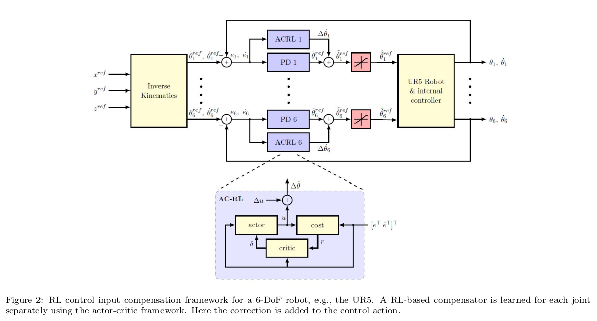
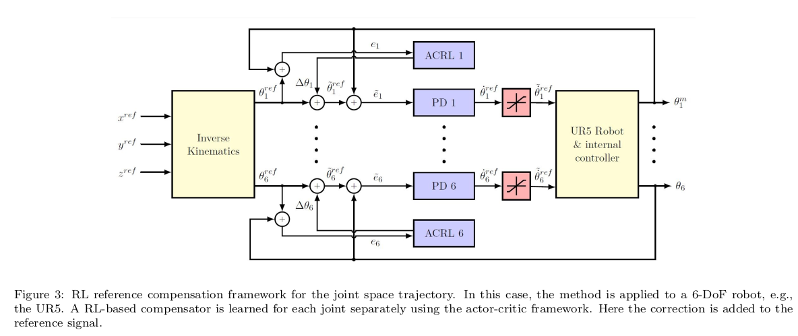
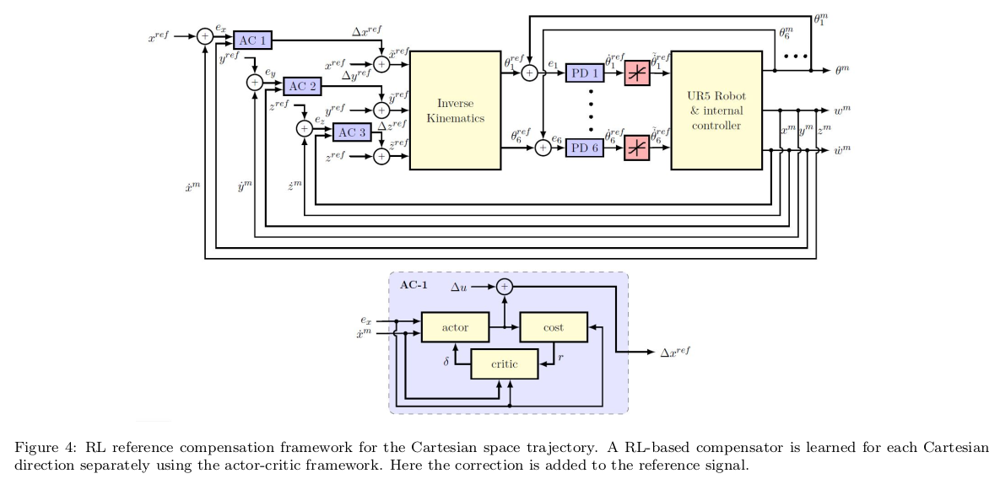
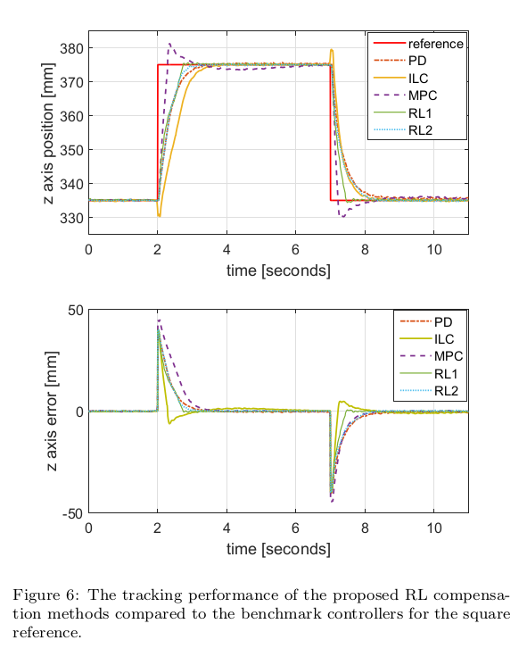
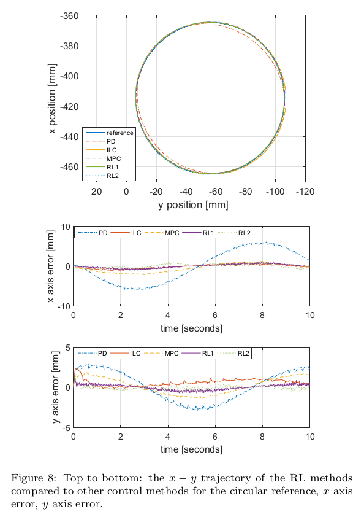
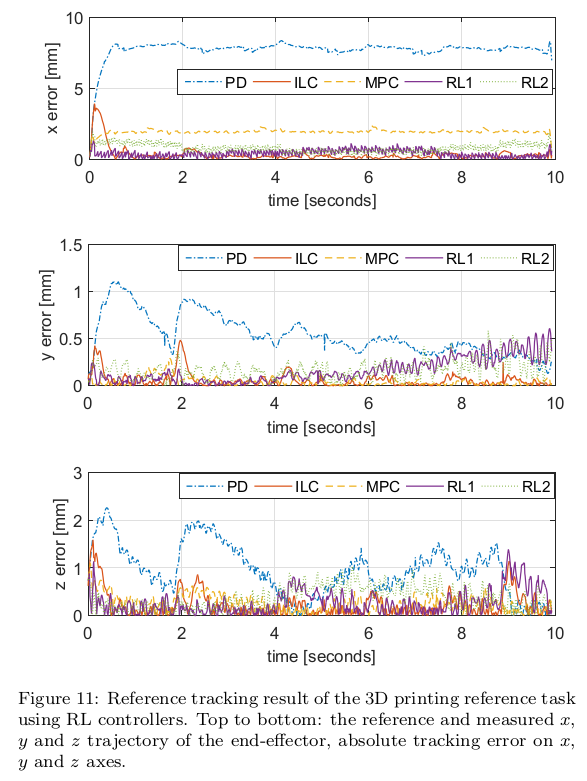

::: {.callout-note title="🔗 Links"}
- [🌐 Project Page](https://open-robot-lab.github.io/HIMLoco/)
- [📄 Paper (arXiv)](https://arxiv.org/abs/2312.06370)
- [📦 Code](https://github.com/OpenRobotLab/HIMLoco)
:::

::: callout-note
Reinforcement Learning Based Compensation Methods for Robot Manipulators
:::

# 배경 및 문제 정의

기존 산업용 6축 로봇은 제조사에서 제공하는 고정된 모델기반 제어기를 사용하지만, 실제 운용 중 마찰 증가, 기어 마모, 페이로드 변화 등 비모델링된 동역학이 발생하면 추적 성능이 급격히 저하됩니다. 이 논문은 기존 안정화 제어기 위에 RL 보상기를 추가하여 모델 없이도 실시간으로 오차를 보정하는 방법을 제안합니다.
목표는 self-optimizing 능력을 부여해 빠른 조정과 높은 정밀도를 동시에 달성하는것입니다

## Contribution

- 세 가지 RL기반 보상 방법
  - Control Input Compensation (제어 입력 보상)
  - Reference Compensation (레퍼런스/커맨드 신호 보상)
- 기존 제어기 위에 추가 모듈 형태로만 작동 (안전하고 즉시 적용 가능)
- PD, MPC, ILC와 정량 비교

# 논문 개요
논문은 기존 제어기 위에 RL 보상기를 얹는 공통 프레임워크를 사용합니다.
기존 제어기는 그대로 두고, RL이 추가 보정 신호만 학습합니다.

## 방법1: Input Compensation

- 로봇이 실제로 받는 joint velocity command에 약간의 보정값을 더해줌. 가장 빠르고 정확하지만, 노이즈나 진동에 더 민감함. 즉 관절별로 독립된 RL agent가 보정신호를 계산.

$$
x = \begin{bmatrix} e_\theta \\ \dot{e}_\theta \end{bmatrix} = \begin{bmatrix} \theta_{\text{ref}} - \theta \\ \dot{\theta}_{\text{ref}} - \dot{\theta} \end{bmatrix}
$$
$$
u_i = g(e_i) + h(e_i) \quad \text{(h = 학습된 RL 정책)}
$$
$$
보상함수 \rho = \begin{bmatrix} e & \dot{e} \end{bmatrix} Q \begin{bmatrix} e \\ \dot{e} \end{bmatrix} 
$$

## 방법2: Reference Compensation

- joint 혹은 Cartesian space에서 error 정의 이후, 기존 제어기에 들어가는 reference command를 보정해줌. 즉 원시 reference값에 직접 더해지기때문에 목표를 조금 옮겨주는느낌.

$$
x = \begin{bmatrix} e_w \\ \dot{w} \end{bmatrix} \quad \text{(x, y, z 중 필요한 축만)}
$$
$$
\tilde{\theta}_{\text{ref}} = \theta_{\text{ref}} + p(e)
$$
보상함수는 동일함.

**두 방법의 차이**
- 방법1: 힘을 직접 밀어줌 -> 빠르고 정확하지만 진동 가능성 있음
- 방법2: 목표를 살짝 옮겨줌 -> 부드럽고 안정적이지만 반응속도가 좀 낮음

## Experiments

- **세 가지 추적 과제**
  - **정사각형 경로**: z축 오차 최소화
  - **원형 경로**: x-y 오차 최소화
  - **3D 곡면 인쇄 경로**: x-y-z 전체 오차 최소화

- **비교 제어기**
  - **PD**: 모델-프리 기본 제어기
  - **선형 MPC**: 모델 기반 제어기
  - **선형 ILC**: 반복 학습 기반 적응 제어기

- **주요 성능 지표**
  - **RMS 오차**: 전체 추적 품질
  - **최종 steady-state 오차**
  - **최대 절대 오차**
  - **학습 수렴 속도**: 필요한 trial 수

- **결과 해석**
  - **과제 1: 정사각형 경로**
    - RL 입력 보상은 RMS 오차에서 ILC보다 우수하고, steady-state 오차도 PD보다 크게 개선됨
    - RL 참조 보상은 더 빠른 학습 수렴을 보임 (170 trials vs. 350 trials)
    - MPC보다 더 낮은 RMS 오차를 보여, 불연속 참조 입력에서도 안정적으로 동작함

  - **과제 2: 원형 경로**
    - 두 RL 방법 모두 PD, MPC, ILC 대비 전반적으로 우수한 성능을 보임
    - 입력 보상은 가장 낮은 x/y 축 오차를 달성함
    - 참조 보상은 가장 부드러운 움직임을 보임

  - **과제 3: 3D 인쇄 경로**
    - 가장 어려운 과제로, 로봇 팔이 많이 펴진 구간에서 추적이 수행됨
    - RL 입력 보상은 x축에서 최고 성능을 보였고, y/z축에서는 ILC보다 약간 뒤처짐
    - RL 참조 보상은 최대 절대 오차 측면에서 ILC보다 우수함
    - 전체적으로 RL 방법이 모델 없이도 충분히 경쟁력 있음을 보여줌

- **공통 관찰**
  - 모든 과제에서 RL 방법은 약간의 진동(jitter)이 있었지만, 기존 제어기와 비교해 허용 가능한 수준이었음
  - 학습 수렴 속도는 참조 보상 방식이 항상 더 빨랐으며, 약 30~300 trials 범위에서 수렴함
  - 입력 보상은 정확도 향상에 유리하고, 참조 보상은 부드러운 동작에 유리하여 목적에 따라 선택 가능함

- **결론**
  - 본 논문은 기존 산업용 로봇 제어기 위에 RL 보상기를 추가하는 것만으로도, 별도의 정밀 모델 없이 실시간 성능 향상이 가능함을 실험적으로 보였음
  - 특히 Industry 4.0 환경처럼 작업 조건이 자주 바뀌는 상황에서, 재튜닝 없이도 고정밀 추적 성능을 유지할 수 있는 실용적인 해법을 제시함
