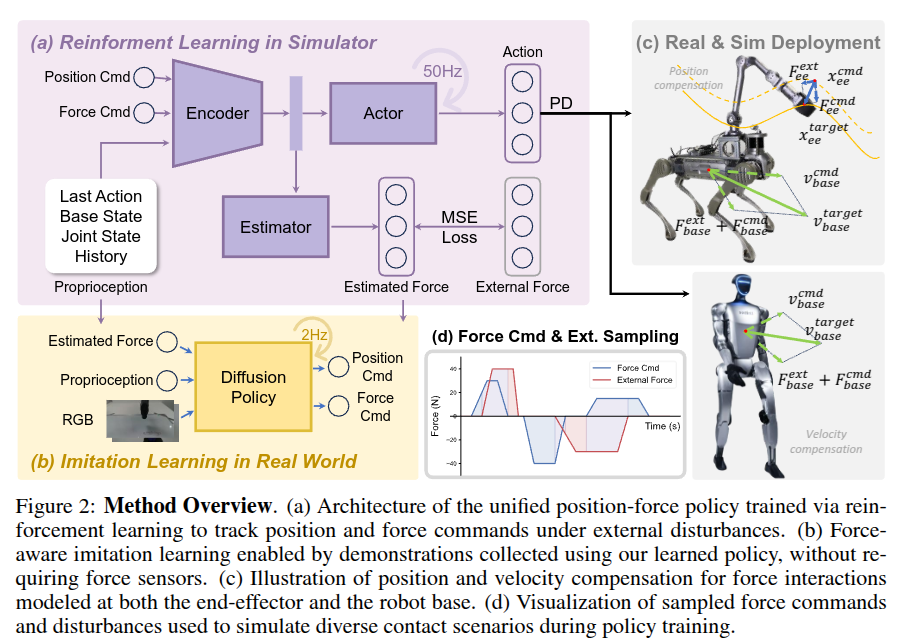
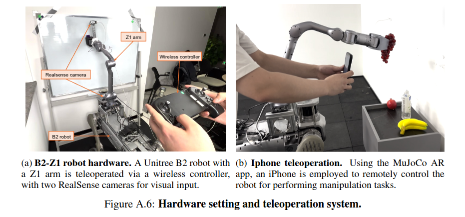
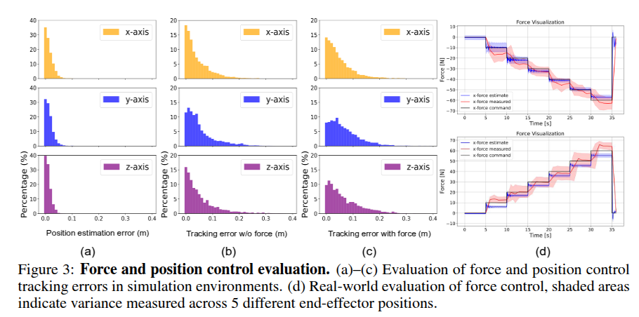
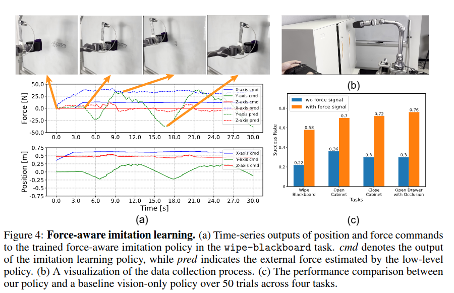
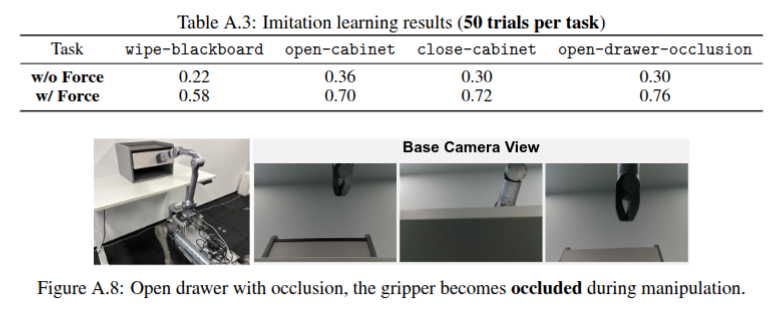
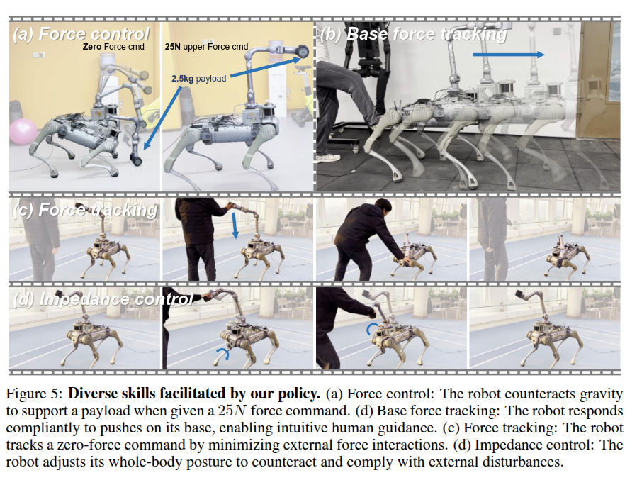

::: {.callout-note title="🔗 Links"}
- [🌐 Project Page](https://unified-force.github.io/)
- [📄 Paper (arXiv)](https://arxiv.org/html/2505.20829v1)
- [📦 Code]( )
:::

::: callout-note
Force-Aware Loco-Manipulation for Legged Robots via Learned Unified Control
:::

# 배경 및 문제 정의

현대 loco-manipulation에서는 로봇이 환경과 접촉하며 물체를 밀고/당기는 등의 작업을 수행합니다. 그러나 다음의 제약이 존재합니다.

- **높은 자유도와 복잡성**: legged robot은 운동학적으로 복잡하고, manipulation 과제가 추가되면 난도가 더 증가합니다.  
- **접촉 힘 모델링의 중요성**: 원하는 동작을 위해서는 **접촉 힘(contact force)**의 정확한 모델링이 필수입니다.  
- **힘 센서의 부재**: 비용·무게 등의 이유로 **F/T 센서가 없는** 경우가 많아 접촉력 정보가 부족합니다.  
- **분절된 제어 패러다임**: 최근 RL 프레임워크는 **position control** 또는 **force control** 중 한 가지에만 초점을 두는 경향이 있습니다.  
- **통합 학습의 부족**: 위치·힘 제어를 동시에 학습/통합하는 연구가 부족해 **복잡한 실세계 접촉 작업**을 다루기 어렵습니다.  
- **모방학습의 한계**: 대규모 데이터셋도 **reference trajectory 중심**이며, 힘 정보가 빠져 있어 **간단한 접촉 작업**에도 한계가 드러납니다.

> 결론적으로, **순수 위치 제어만으로는 섬세한 접촉 작업을 수행하기 어렵다**는 근본적 한계가 있습니다. 본 논문은 **힘 센서 없이**도 위치·힘 제어를 **통합적으로 학습·활용**하는 방법을 제시합니다.

# 주요 기여(Contributions)

1. **힘 센서 없이** 위치–힘 제어를 **통합 학습**하는 최초의 프레임워크 제안.  
2. 해당 프레임워크로 **position tracking, force application, force tracking, compliant interaction** 등 **다양한 조작 행동**을 구현.  
3. **히스토리 데이터**로부터 **외력(반력 포함)을 추정**하고, 이를 바탕으로 **목표 위치/속도 보상**을 수행 → **무센서 힘 제어**를 가능하게 하는 핵심.

# Methods 개요

본 방법론은 크게 세가지 부분으로 구성됩니다.

* **Unified Control Formulation**
+ 로봇이 외부 힘과 상호작용할 때 이상적으로 어떻게 움직여야하는가를 수학적으로 정의합니다. 강화학습의 목표 (target position/velocity)를 계산하기 위해 기본 방정식을 이용합니다.

* **Learning a Unified Policy**
+ 위에서 정의된 이상적인 목표에 따라 **주어진 힘/위치 명령을 실제로 어떻게 수행할 것인가**를 배우는 저수준 제어 정책을 강화학습으로 구현합니다. 이때 힘 센서 없이 외부 힘을 추정하는 네트워크도 함께 학습합니다.

* **Build a Diffusion Policy**
+ 로봇이 실제 세계의 복잡한 작업을 보고 **무엇을 해야할지** (적절한 힘/위치 명령을 결정하는 고수준 정책)을 모방학습으로 만듭니다. 이 과정에서 위에서 학습한 힘 추정 네트워크를 활용합니다.

## Unified Formulation for Force–Position Control

기본 아이디어는 실제 위치/속도와 목표 값의 오차에 비례하는 힘을 생성해 원하는 움직임을 유도하는 것입니다. 고전적 임피던스 제어는

$$
\mathbf{F} = K(\mathbf{x}-\mathbf{x}^{\mathrm{des}})\;+\;D(\dot{\mathbf{x}}-\dot{\mathbf{x}}^{\mathrm{des}})\;+\;M(\ddot{\mathbf{x}}-\ddot{\mathbf{x}}^{\mathrm{des}})
$$

로 표현됩니다. 여기서 \(K,D,M\)은 각각 **stiffness, damping, equivalent mass/inertia** 입니다.

**quasi-static**에서는 \(\ddot{\mathbf{x}}\!\approx\!\ddot{\mathbf{x}}^{\mathrm{des}}\)이고 \(\dot{\mathbf{x}}\!\approx\!\dot{\mathbf{x}}^{\mathrm{des}}\)라 가정하면

$$
\mathbf{F}\;\approx\;K(\mathbf{x}-\mathbf{x}^{\mathrm{des}})
$$

로 단순화할 수 있습니다.

이때 총 힘 \(\mathbf{F}\)는 다음 3가지 구성으로 해석합니다.

- **Active force \(\mathbf{F}^{\mathrm{cmd}}\)**: 로봇이 환경에 **가하고자 하는 명령 힘**  
- **Passive reaction \(\mathbf{F}^{\mathrm{react}}\)**: 환경이 로봇에 **되받아치는 반력**  
- **External disturbances \(\mathbf{F}^{\mathrm{ext}}\)**: 외부에서 가해지는 교란

이를 고려하면 **엔드 이펙터 목표 위치**는

$$
\mathbf{x}^{\mathrm{target}}
=
\mathbf{x}^{\mathrm{cmd}}
+
\frac{\mathbf{F}^{\mathrm{ext}}+\big(\mathbf{F}^{\mathrm{cmd}}-\mathbf{F}^{\mathrm{react}}\big)}{K}
$$

로 정의됩니다. 로봇은 단순히 \(\mathbf{x}^{\mathrm{cmd}}\)만 추종하지 않고, **외력/반력에 따라 목표를 보정**해 **힘 명령을 만족**시키도록 동작합니다.  
예시:
- \(\mathbf{F}^{\mathrm{cmd}}=0,\;\mathbf{F}^{\mathrm{ext}}=0 \Rightarrow \mathbf{x}^{\mathrm{target}}=\mathbf{x}^{\mathrm{cmd}}\) → **순수 위치 제어**  
- \(\mathbf{F}^{\mathrm{cmd}}=0 \Rightarrow \mathbf{x}^{\mathrm{target}}=\mathbf{x}^{\mathrm{cmd}}+\mathbf{F}^{\mathrm{ext}}/K\) → **외력에 유연한 순응**  
- \(\mathbf{F}^{\mathrm{cmd}}\neq 0\) → 반력 \(\mathbf{F}^{\mathrm{react}}\)가 \(\mathbf{F}^{\mathrm{cmd}}\)와 일치하도록 \(\mathbf{x}^{\mathrm{target}}\)이 **자동 조정**

**베이스**에 대해서는 속도 제어를 중시해 단순화합니다. 임피던스 아이디어를 속도 영역에 적용하면,

$$
\mathbf{v}^{\mathrm{target}}_{\mathrm{base}}
=
\mathbf{v}^{\mathrm{cmd}}_{\mathrm{base}}
+
\frac{
\mathbf{F}^{\mathrm{ext}}_{\mathrm{base}} + \big(\mathbf{F}^{\mathrm{cmd}}_{\mathrm{base}}-\mathbf{F}^{\mathrm{react}}_{\mathrm{base}}\big)
}{D}
$$

가 되며, 엔드 이펙터 제어와 **독립적으로** 다룹니다(복잡성 저감).

## Learning a Unified Policy

observation 집합은 다음과 같습니다.

$$
\mathbf{o}_t
=
\big[
\mathbf{g}^{\mathrm{base}}_t,\;
\boldsymbol{\omega}^{\mathrm{base}}_t,\;
\mathbf{q}_t,\;
\dot{\mathbf{q}}_t,\;
\mathbf{a}_{t-1},\;
\mathbf{c}^{\mathrm{cmd}}_t,\;
\boldsymbol{\theta}^{\mathrm{feet}}_t
\big]
$$

command 벡터는 **베이스/엔드 이펙터의 위치·힘/속도** 명령을 포함합니다.

$$
\mathbf{c}^{\mathrm{cmd}}_t
=
\big[
\mathbf{v}^{\mathrm{cmd}}_{\mathrm{base}},\;
\mathbf{x}^{\mathrm{cmd}}_{\mathrm{ee}},\;
\mathbf{F}^{\mathrm{cmd}}_{\mathrm{ee}},\;
\mathbf{F}^{\mathrm{cmd}}_{\mathrm{base}}
\big]
$$

> 4족 로봇은 아래 **명령 벡터**의 네 항목을 모두 사용하고, 휴머노이드는 $v_{base}^{cmd}$ 와 $F_{base}^{cmd}$ 만 사용합니다.

이 학습 프레임워크에는 policy network뿐만 아니라 아래의 두가지 네트워크도 포함됩니다.

1. **Observation Encoder**  
   길이 \(H=32\)의 히스토리를 받아 **latent feature**를 추출하고, 이를 Actor 네트워크에 입력해 **action**을 출력합니다.

2. **State Estimator**  
   Encoder의 latent를 입력으로 받아 **외력 \((\mathbf{F}=\mathbf{F}^{\mathrm{ext}}+\mathbf{F}^{\mathrm{react}})\)**, **엔드 이펙터 위치 \(\mathbf{x}_{\mathrm{ee}}\)**, **베이스 속도 \(\mathbf{v}_{\mathrm{base}}\)** 를 **추정**합니다.

본 정책은 특정 태스크 전용의 고수준 정책이 아니라, **임의의 힘 명령을 안정적으로 추종**하고 **외력에 순응**하는 **저수준 통합 제어 루프**를 학습합니다. 예를 들어 **\(-60\sim 60\,\mathrm{N}\)** 범위의 다양한 \(\mathbf{F}^{\mathrm{cmd}}\)에 노출되며, 어떤 값이 주어져도 정확히 달성하도록 훈련됩니다.

## Build a Diffusion Policy

위에서 만든 Actor Policy는 주어진 position force command를 어떻게 추종하는지는 알지만, RGB이미지나 환경 인지를 통해 무엇을 해야할지 스스로 판단하여 명령을 생성할 수는 없습니다.
즉, 이제는 적절한 명령 (position, force command)를 생성하는 **상위 제어기**를 만들어야 합니다. 

먼저, 각 작업별로 텔레오퍼레이션을 통해 사람이 조이스틱을 사용하여 로봇의 base움직임, end effector 위치, end effector force를 직접 명령합니다. 

텔레오퍼레이션 과정에서 기록되는 데이터는 다음과 같이 쌍을 이룹니다

* 입력: proprioception, RGB image, estimated end effector 외력 
* 출력: position command, force command (Diffusion Policy의 학습 목표이자 예측 출력)

즉, 텔레오퍼레이션 시 사람이 조작하여 로봇에 전달한 position, force command는 Diffusion Policy의 출력 (action)을 학습하는 정답 라벨로 사용됩니다.

Diffusion Policy는 모방 학습 기법의 일종이고, 모방학습은 일반적으로 **전문가 시연(expert demonstrations)**으로부터 상황-행동 맵핑을 학습합니다.

* 학습 입력: 특정 proprioception, RGB image, estimated end effector 외력 상태가 주어졌을 때,
* 학습 출력: 이 상태에서 전문가(사람 텔레오퍼레이터)가 어떤 position command와 force command를 내렸는지를 학습합니다.
* Diffusion Policy는 단순히 하나의 정답을 외우는 것이 아니라, 전문가가 해당 상황에서 내릴 수 있었던 command 들의 확률 분포를 학습합니다.

학습이 완료된 Diffusion Policy는 자율모드에서 작동합니다. Diffusion Policy는 어떤 command도 입력으로 받지 않지만, 현재 상황을 파악하고 스스로 새로운 command를 생성합니다.

자세한 내용은 아래 논문에서 확인할 수 있습니다.

[Diffusion Policy: Visuomotor Policy Learning via Action Diffusion](https://arxiv.org/abs/2303.04137)

---

# Experiments

실험은 크게 네 가지로 나뉘며, **Unified Force-position Policy**와 이를 활용한 **Force-aware Imitation Learning**의 효과를 검증하는 데 초점을 맞춥니다.
Unitree B2-Z1 4족로봇, Unitree G1 휴머노이드 로봇이 사용되었습니다.

## Force and Position Command tracking

Actor Policy 자체의 기본 성능, 즉 주어진 명령을 얼마나 정확하게 추적하고 외부 힘을 잘 추정하는지를 평가합니다.

* **Position tracking**
   - 목표: 외부 힘이나 힘 명령이 없는 상황에서 로봇의 end effector가 위치 명령을 얼마나 정확하게 추적하는지 시뮬레이션에서 평가하고, state estimator의 위치 추정 정확도를 확인.
   - 방법: 시뮬레이션에서 6000step의 rollouts을 수행하고 무작위로 생성된 end effector 궤적을 따르도록 지시함.
   - 측정: end effector tracking error 및 state estimator error.
   - 결과: tracking error는 대부분 0.1m 이내로 유지, state estimator 추정오차는 0.05m 이내로 유지.

* **Force control**
   - 목표: Actor Policy가 외부 힘을 추정하고 이에 대응하며 힘 명령을 수행하는 능력을 시뮬레이션 및 실제환경에서 평가합니다.
   - 방법(**sim**): 로봇이 외부 힘을 받는 동시에, 이 외부 힘과 동일한 힘 명령을 받도록 설정.
   - 측정: end effector tracking error.
   - 결과: 외부 힘이 없을 때보다 약간 증가하지만, 여전히 대부분 0.1m 이내로 유지. 이는 정책이 힘 상호작용 상황에서도 효과적으로 행동함을 보여줌.
   - 방법(**real**): 실제 로봇에 장착된 end effector에 dynamometer를 부착하여 실제 가해지는 힘을 측정.
   - 명령: 0N부터 60N까지 다양한 범위의 힘 명령을 로봇에 직접 입력.
   - 측정: 다이나모미터로 측정한 실제 힘과 로봇에 입력한 힘 명령간의 오차를 측정하고, state estimator가 추정한 힘의 정확도도 평가.
   - 결과: 평균 오차가 10N이내로 나타남. state estimator의 추정오차는 5~10N 내외.

## Force-aware Imitation Learning

Diffusion Policy의 효과를 실제 로봇 환경에서 검증합니다. 특히 Estimated Force 정보다 모방 학습 성능에 어떤 영향을 미치는지 보여줍니다.

세가지 조작 환경은 다음과 같습니다.

* **wipe-blackboard**: 칠판 표면에 지속적인 접촉 압력을 유지하며 횡방향으로 움직여 잉크를 지우는 작업입니다.
* **open/close cabinet**: 캐비닛의 문을 밀어서 열거나 닫는 작업입니다. 3mm의 매우 좁은 스트로크로 인해 시각정보만으로는 트리거하기 어려우며, 정확한 힘 감지가 필요합니다.
* **open-drawer-occlusion**: 시각적으로 가려진(occluded) 상태에서 서랍을 밀어서 여는 작업입니다.

우선, 각 작업에 대해 텔레오퍼레이션을 통해 force aware dataset을 수집합니다. 수집한 데이터를 이용해서 Diffusion Policy를 학습합니다. 각 작업당 50회 시도했으며, 각 시도는 20초 내 성공여부를 판단합니다.
또한, 텔레오퍼레이션 데이터 수집 시 **force estimator**와 **force command**신호를 제외한 position-only 정보만 사용한 Diffusion Policy를 비교군으로 삼았습니다.

결과는 아래와 같습니다.

* **wipe-blackboard**: baseline 22% -> Force-aware 58%
* **open-cabinet**: baseline 36% → Force-aware 70% (미세한 접촉 압력 감지)
* **close-cabinet**: baseline 30% → Force-aware 72%
* **open-drawer-occlusion**: baseline 30% → Force-aware 76% (시각적으로 가려진 접촉 감지)

## Basic Manipulation Policies

Unified Force-position Policy가 다양한 기본 힘-위치 제어를 어떻게 수행하는지 보여줍니다.

* **Force Control**
   + 목표: force command를 직접 적용하는 능력
   + 방법: 2.5kg 아령을 end effector에 부착한 후, 로봇에게 25N의 상향 힘 명령을 줍니다.
   + 결과: 로봇은 아령의 중력에 대항하여 균형을 유지. 명령이 없으면 아령은 중력에 의해 떨어짐. 이는 force command와 force react가 일치하도록 target position이 조정되는 과정을 보여줍니다.

* **Force Tracking** 
   + 목표: 외부 힘에 반응하여 움직이지만, 힘이 제거되면 원래 위치로 돌아오지 않고 변위된 위치에 머무는 능력.
   + 방법: force command를 0으로 설정한 후, end effector에 외력을 가했다가 제거.
   + 결과: end effector는 외력 방향으로 움직이고, 힘이 제거된 후에도 변위된 위치에 머뭄. 이는 외력에 의해 위치 명령이 동적으로 조정되는 과정을 보여줍니다.

* **Impedance Control**
   + 목표: 목표 위치를 추적하면서도 외부 힘에 스프링-댐퍼 시스템처럼 유연하게 반응하는 능력.
   + 방법: 사람-로봇 팔씨름, 줄다리기 시나리오에서 외력을 가함.
   + 결과: end effector가 목표 위치에서 멀어질수록 로봇이 더 큰 저항력을 발휘하여 임피던스 행동을 보임. 이는 Actor Network학습 시 사용한 공식에 따른 유연한 반응을 보여줍니다.

# Conclusion

이 논문은 legged robot이 명시적인 힘 센서 없이도 loco-manipulation작업을 수행할 수 있도록 하는 unified force-position control을 수행했습니다.
강화학습을 통해 학습한 정책은 **position tracking, force application, compliant interactions**과 같은 다양한 제어를 가능하게 했습니다. 또한 **외부 힘을 효과적으로 추정**하여 로봇의 위치 및 속도를 조정해 외부 힘에 대응할 수 있도록 했습니다.

추가로, 모방학습 파이프라인에 **힘 추정 모듈**을 통합함으로써, 접촉이 많은 환경에서 로봇의 작업 성공률을 크게 향상시켰습니다. 이 전반적인 과정은 자율 로봇의 실용적인 응용 가능성을 넓히는 데 기여합니다.